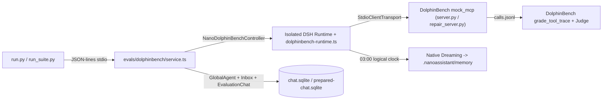

# feat-806: As-built Design

> 本文在实现完成后根据实际代码、diff 与已确认决定整理，描述最终落地设计。

## 实现范围

- Base: `890d74f70` (`origin/develop`)
- Head: 待最终归档提交更新
- Included files:
  - `packages/dsh-integration/package.json`
  - `packages/dsh-integration/src/evaluation.ts`
  - `packages/dsh-integration/src/evaluation/dolphinbench-runtime.ts`
  - `packages/dsh-integration/src/evaluation/dolphinbench.ts`
  - `packages/dsh-integration/tests/dolphinbench-evaluation.test.ts`
  - `evals/README.md`
  - `evals/dolphinbench/README.md`
  - `evals/dolphinbench/service.ts`
  - `evals/dolphinbench/run.py`
  - `evals/dolphinbench/run_suite.py`
  - `tests/unit/test_dolphinbench_runner.py`
- 受影响模块：`@nano/dsh-integration/evaluation`、`evals/dolphinbench`

## 最终结构

### 组件与职责

1. **隔离运行时插件（`packages/dsh-integration/src/evaluation/dolphinbench-runtime.ts`）**：
   - 通过公开 DSH Cordis/session/compaction/tools 钩子挂载评测控制面（Unix domain socket `RpcPeer`）；
   - 接管 `Dreaming.useClock()` 逻辑时钟，支持自然日凌晨 `03:00` 自动巩固及可选 `dreamMinIntervalDays` 多日合并消融；
   - 在新会话边界通过 `compact-checkpoint` 将上一轮活动窗口归档出当前上下文，保持单根持久化 `rootSessionId`；
   - 通过 `@modelcontextprotocol/client` 动态连接每轮/每题的 stdio 模拟应用服务（`server.py` / `repair_server.py`），并将工具文本输出统一包装为 `{ text: string }` 以兼容返回 JSON 数组的查询类 MCP 工具；
   - 在前台通过 `ctx.tools.guard` 阻断记忆仓与随包技能目录之外的宿主文件读取，并禁用本地编码子代理委派（`delegate_worker`、`subagent`），避免空工作区无效自旋。
2. **阶段控制器（`packages/dsh-integration/src/evaluation/dolphinbench.ts`）**：
   - `NanoDolphinBenchController` 管理持久摄入（`openIngestion`、`ingestSession`、`freezeIngestion`）与冷上下文测试（`runTest`）；
   - 每完成一轮摄入原子刷新 `chat-checkpoint.sqlite`，封板时生成相对路径 `prepared.json` 并记录 `.nanoassistant/memory` 的 SHA-256 摘要；
   - 单题测试在 `/tmp` 独立沙箱中冷启动，每次校验封存记忆摘要未变，按 `product` / `memory-only` / `search-only` 控制记忆树复制与聊天检索开关，结束后立即回收临时目录。
3. **产品桥与 CLI 协调器（`evals/dolphinbench/service.ts`、`run.py`、`run_suite.py`）**：
   - `service.ts` 组合 `GlobalAgent`、`InboxStore`、`NodeStore`、`TaskContext` 与 `EvaluationChat`，按人物所属时区（`America/Los_Angeles`、`America/New_York`、`America/Chicago`）对齐消息时间戳；
   - `run.py` 提供 `--plan-only`、`--session-range`、`--arms`、`--phase {all,ingest,test}`、`--test-workers`、`--ingestion-state-dir`、`--dream-min-interval-days` 及每 250 轮自动重启运行时进程防内存累积，调用 DolphinBench 官方 `grade_tool_trace` 评分并在单题评分后清理大体积可变 `state.json` 副本；
   - `run_suite.py` 通过 `.suite.lock` 文件排他锁与全局并发槽位调度多人物并行摄入与封板后并发测试，持续刷新 `live-status.json`。

### 调用链与数据流

### 状态、数据与兼容性

- 所有运行状态、SQLite 快照与轨迹均写入外部指定的 `--output` / `--ingestion-state-dir`，不触碰 `~/.nanoassistant` 或仓库受管目录。
- `manifest.json` 持久化 `planSha256`；参数不一致时拒绝复用旧输出目录，防止不同实验配置串扰。
- 无生产数据或配置迁移需求，不生成 `deployment-prompt.md`。

## 关键决策

| 决策 | 原因与约束 | 代码定位 |
|---|---|---|
| 评测插件仅走 `@nano/dsh-integration` 已声明公开 DSH 依赖 | 遵守架构红线：PA/IM 不依赖 DSH，不引入内核补丁或私有导入 | `packages/dsh-integration/src/evaluation/dolphinbench-runtime.ts` |
| MCP 工具输出统一封装为 `{ text: string }` 并在 `render` 还原文本块 | DolphinBench `list_*` 工具返回顶层 JSON 数组文本，直接声明 object schema 会触发 DSH 输出校验报错 | `packages/dsh-integration/src/evaluation/dolphinbench-runtime.ts` |
| 预收集 `repair_server.py` 伴随查询类名并注入 `toolAllowlist` | 测试期修复工作区会暴露伴随查找工具，需通过产品配置白名单而非篡改冻结的 `options.tools` | `evals/dolphinbench/run.py`、`packages/dsh-integration/src/evaluation/dolphinbench.ts` |
| 单题冷测工作区落地本机 `tmpdir()`，评分后即时移除临时目录与 `state.json` 副本 | 避免外置磁盘符号链接限制与数千道题的磁盘膨胀，同时保留 `calls.jsonl` 与评分证据 | `packages/dsh-integration/src/evaluation/dolphinbench.ts`、`evals/dolphinbench/run.py` |

## 失败路径、风险与回滚

- **单轮网关/超时瞬时故障**：摄入轮回滚模拟应用 `state.json` 备份并重建 `ServiceBridge` 后按指数退避重试；测试轮在全新临时目录与重置后的模拟应用状态上重试，不把语义判分不通过当作重试条件。
- **跨进程误重入**：`run_suite.py` 通过 `fcntl.flock` 独占 `.suite.lock`，重复启动立即拒绝退出。
- **回滚方式**：本单元全部为新增评测模块与两处评测导出重导出，回滚该提交即可完全移除，不影响任何产品运行链路。

## 与初始意图的差异

- 在验证 Morgan `1:10` 三路消融与 `1:753` 长程摄入后，根据用户讨论新增了 `--dream-min-interval-days` 评测侧巩固间隔消融开关，并将默认缓存目录改为基于 `Path.home()` / `DOLPHINBENCH_ROOT` 解析以消除主机硬编码路径。

## 本次审查安排（按实际实现校正）

| 审查编组 | 必须回答的问题 | 能力与所需证据 | 已有用户验收 / 证据定位与缺口 |
|---|---|---|---|
| 独立代码审查 | 跨包依赖边界、工具沙箱隔离、断点恢复幂等性、时区与资源清理是否正确 | `change-code-review` + 完整 diff + 自动化测试输出 | Morgan `1:10` 三路消融与 `1:753` 真实运行已由用户确认；补充确定性集成与单元测试覆盖 |

## 验证定位

- **用户验收**：Morgan `1:10` 三路消融（`product` 3/3、`memory-only` 3/3、`search-only` 2/3）及 `1:753` 长周期运行与封存对比基线已获用户确认。
- **自动化测试**：
  - `packages/dsh-integration/tests/dolphinbench-evaluation.test.ts`（确定性端到端：跨日摄入、`03:00` Dreaming、换窗、MCP 数组工具、封板摘要、`product`/`memory-only`/`search-only` 三路隔离与越界读取拦截）；
  - `tests/unit/test_dolphinbench_runner.py`（切片解析、多人物时区与夏令时、可解题筛选、`repair_server` 挂载、套件进度聚合）；
  - `tests/contract/test_runtime_dependency_contract.py` 与 `./scripts/docs-check`。
- **运行证据**：`/Users/czj/.cache/nano-evals/runs/morgan-v0-baseline-s1-753-20261128/v0-baseline-summary.json`（本地研究快照，不入库）。

## Canonical 文档影响

- Delta-spec：`no spec delta`
- 归并目标：无（评测套件索引已同步更新至权威入口 `evals/README.md` 与 `evals/dolphinbench/README.md`）
- 若无变更，原因：本次变更仅新增离线评测套件与 `@nano/dsh-integration/evaluation` 评测控制适配层，未改变面向终端用户、客户端、对端节点或生产模型的正式产品契约（与 `feat-677` 口径一致）。
