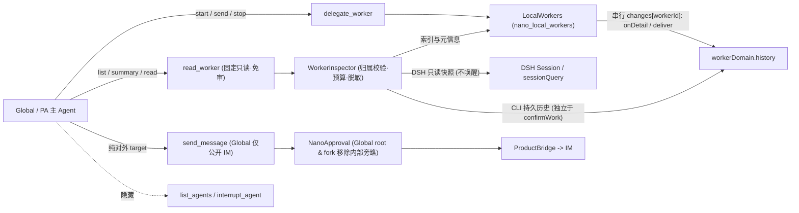
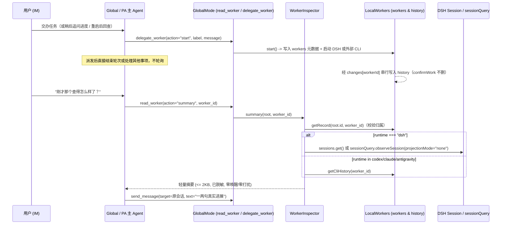

# feat-817: Global / PA Worker 统一只读观测与对外消息边界收口 — 技术方案

> 对齐: [spec.md](spec.md)

## Changelog

## 现状分析

### 涉及范围

- **`packages/dsh-integration/src/local-workers/`**（`manager.ts`、`work-details.ts`、新增 `inspector.ts`）：当前 `LocalWorkers` 持久化管理跨运行时（DSH / Codex CLI / Claude Code / Antigravity CLI）一级 Worker 的元数据与 Work 同步队列（`nano_local_workers` 域的 `workers`、`reports` 表），但外部 CLI Worker 的步骤明细仅挂在 `row.pending` 中，经 IM `confirmWork()` 确认后即被清空，且没有时间戳、轮次计数、最近汇报缓存或统一只读查询接口。
- **`packages/dsh-integration/src/global-mode.ts`**：`GlobalMode.apply` 同时在两处挂载——非 Global（`single_thread`）模式在 `agent-config.ts:129` 的 preset 级挂载，Global 主 Agent 与显式 root fork 在 `agent-config.ts:190` 的 `agent.ctx` 局部级挂载。当前 `send_message` 在两种模式下共用同一定义与 `execute`（含 `agent`/`agent_id`/`message` 内部转发分支与尾部内部引导描述），且尚未注册 `read_worker`。
- **`packages/dsh-integration/src/capabilities.ts`**：`ToolSelection.refresh` 负责主 Agent 与子 Agent 的工具收敛与隐藏。当前 Global 主 Agent（及显式 root fork）已隐藏 `subagent`，但仍放行仅覆盖 DSH 子会话的原生 `list_agents` 与 `interrupt_agent`；同时 L113 的 `tools.restrict({ allow })` 必须排除所有 Global scope-local 局部注册工具（否则 DSH `tools.restrict` 对未知全局工具名直接抛错）。
- **`packages/dsh-integration/src/policy/approval.ts`**：`NanoApproval.review` 负责工具免审白名单（`safeTools`）与 `send_message` 预处理/审核路由。当前 L129 在获取 `agent`/`config` 之前即按 `!isInternalSendArgs` 跳过 `normalizeMessageArguments`，L166 又按 `isInternalSendArgs` 放行 `safe_tool` 免审旁路。
- **`packages/dsh-integration/src/evaluation/runtime.ts`**：排除不产生工作区副作用的产品工具列表，需同步收录 `read_worker`。
- **`packages/product-contracts/src/capabilities.ts`** 与 **`src/IM/ios/NanoIM/Features/Agents/CapabilitySelection.swift`**：定义各模式下不可关闭的固定基础工具集合（`fixedTools` / `AgentCapabilities.modeFixedTools`），需同步加入 `read_worker` 并更新 `packages/product-contracts/tests/` 与 `src/IM/ios/Tests/AgentContractsTests.swift`。
- **`src/IM/frontend/src/i18n/{en,zh}.json`** 与 **`src/IM/frontend/src/features/settings/agents/agent-create.test.tsx`**：更新全局模式固定工具提示文案（同步加入 `read_worker` 并补齐既有 `download_attachment`）与测试断言。
- **`packages/personal-assistant/assets/skills/nano-ongoing-work/SKILL.md`**：该 Skill 同时面向 Global / PA 主 Agent 与内部 Worker；更新时需明确区分主 Agent 专属的 `delegate_worker`/`read_worker` 与内部 Worker 沿用的原生 `subagent`/`send_message`（及外部 CLI 的 `nano-parent` `send_message`），并补充 `read_worker` 分层查看与克制读取纪律。
- **关联测试**：`packages/dsh-integration/tests/{global-child-tools,local-worker-manager,capabilities,knowledge-review,subagent-recovery-and-model-cascade}.test.ts`、`apps/node/tests/capabilities.test.ts` 等。

### 既有约束

- **DSH 公开边界**：只通过已声明的 DSH 公开 exports 读取 DSH 子会话（`ctx.sessions.get` 与 `ctx.sessionQuery.observeSession(..., { projectionMode: 'none' })`），不得 fork/patch DSH 或引入 private import；`packages/personal-assistant` / `packages/channels` / `apps/im-server` 不 import DSH（受 `tests/contract/test_runtime_dependency_contract.py` 验收）。
- **底层执行不变**：本 unit 保持 DSH 进程内执行与外部 CLI（Codex / Claude / Antigravity）独立进程，不迁移 DSH 到 `dsh --profile acp`，不改变外部 CLI Worker 的 `nano-parent` MCP `send_message({ message })` 与 `feat-797` 审批桥，不改变 DSH 嵌套子代理与 `single_thread` 模式。
- **权限与授权来源边界**：`read_worker` 仅归 Global / PA 根主 Agent，只读免审批，但读出的 Worker 输出、外部内容或 Worker 自述永远不得升级为真人授权（不进入 `ApprovalSources.hostResults` 与 `retainInstructions()`）。
- **Prompt Cache 与删除清理一致性**：显式 root fork 须继承与主 Agent 相同的工具声明与系统提示词以保持缓存前缀；Agent 永久删除时 `workers.forget(roots)` 须一并清理新增的持久化 Worker 历史表。
- **非目标隔离**：不修改 `apps/im-server` 与前端 Work 视图协议，不增加 `delegate_worker` 的动态运行时/模型选择参数，不改动 Worker 内部工具名。

### 可复用能力

- **用**：`LocalWorkers`（`packages/dsh-integration/src/local-workers/manager.ts`）的 `nano_local_workers` 域（`layout: 'per-record'`）作为跨运行时一级 Worker 唯一归属索引；`WorkerTurnDetails`（`work-details.ts`）、`extractToolSummary`（从 `work-details.ts` 导出复用）与三类 CLI 驱动产出的 `RuntimeWorkerDetail` 事件流直接复用作外部 CLI 持久化历史来源与 DSH 工具单行摘要；`ctx.sessionQuery.observeSession(SessionId(workerId), { projectionMode: 'none' })` 复用作冷 DSH 子会话的零激活只读快照；`stripContextItemId`（`dsh-agent-context`）与 `screenshotMessageParameters`（`message-arguments.ts`）直接复用。
- **改**：`LocalWorkers` 扩展元数据字段（`createdAt`、`updatedAt`、`turnCount`、`latestReport`、`latestError`）并新增 `history` 持久化表，所有同 `workerId` 写操作统一串行在 `this.changes[workerId]` 且解耦于 `confirmWork()` 清理；`GlobalMode.apply` 按 `config.mode === 'global'` 条件收口；`ToolSelection.refresh`、`NanoApproval.review`、`fixedTools` 做定向收口。
- **不用**：不引入第二套 Worker 注册表或把 DSH 原生事件日志再拷贝一份到 `nano_local_workers`（避免双份正文真相与额外写放大）；不把 `read_worker` 挂进 `apps/im-server`（避免离线不可查和额外跨网依赖）。

### 相关历史

- `feat-778-local-worker-runtimes` / `feat-788-agy-worker-runtime`：引入 `delegate_worker` 与 `LocalWorkers`，奠定 DSH + Codex / Claude / Antigravity 统一一级 Worker 注册表。
- `feat-797-worker-approval-bridge`：建立外部 CLI 提权审批桥与 `nano-parent` MCP 的 `send_message` 职责边界，本 unit 原样保留。
- `feat-798-browser-desktop-mcp`：在 `work-details.ts` 中对 `computer_use` 私有结果（窗口截图、系统剪贴板）做了剥离；本 unit 的 `history` 持久化直接继承该过滤结果，确保私密证据不进入 `read_worker`。
- `feat-705-global-task-delegation`：在 `capabilities.ts` 中隐藏 Global 主 Agent 的 `subagent` 并确立完整事项单一执行者模型，本 unit 沿同一模式隐藏 `list_agents` 与 `interrupt_agent`。

## 架构总览

改动集中在 `packages/dsh-integration`（工具注册、只读投影、持久化存储、工具收敛与审批收口）及共享能力声明（`packages/product-contracts`、`src/IM/ios`、`src/IM/frontend` i18n）。新增深模块 `WorkerInspector` 封装跨运行时投影、分页、预算截断与凭据脱敏，使 `global-mode.ts` 仅做薄参数校验与调用。

**Before → After 关键变化**：
- **Before**：Global 主 Agent 有 `delegate_worker`（只能控不能查）、公私混用的 `send_message`（含 `agent`/`agent_id` 内部转发与免审旁路）、仅见 DSH 的 `list_agents`/`interrupt_agent`；外部 CLI 历史随 `confirmWork()` 清空。
- **After**：Global 主 Agent 工具边界彻底正交——`delegate_worker` 唯一负责对内派发/追问/停止，`read_worker` 唯一负责跨运行时只读列表与分层查看，`send_message` 100% 仅用于对外 IM 公开消息；`list_agents`/`interrupt_agent` 对主 Agent（及显式 root fork）隐藏；外部 CLI 历史独立持久化，DSH 直接只读原生日志；`single_thread` 与内部 Worker 保持原样零回归。

## 关键决策

### 1. `read_worker` 采用三段式显式动作（`list` / `summary` / `read`）+ 严格字节预算，而非单一全量读取接口

- **理由**：用户明确要求防止主 Agent 反复深读 Worker 轨迹消耗大量 Token。将 `summary`（<= 2 KB，仅元信息 + 最近 5 条单行里程碑 + <= 600 字汇报/报错预览）设计为独立一等动作，并让 `read` 默认 `view="messages"`（过滤常规工具调用噪声、仅保留父级交办/Worker 回复与系统通知），需要看工具细节才显式传 `view="activity"`，从 Schema 层制造清晰的“渐进式披露”梯度。配合单页硬预算（`messages` 12,000 字符 / `activity` 10,000 字符）与单条续读（`item_id` + `text_offset`，每片 4,000 字符），即便模型深读也不会爆上下文。
- **拒绝备选**：合并为单一 `read_worker(worker_id, include_tools=true)`，会导致模型在回答简单进度询问时顺手拉回全量工具日志。
- **风险**：若默认摘要过于简略，可能逼迫模型频繁升级到 `read`。缓解：`summary` 明确返回 `state`、`turn_count`、`updated_at`、最近 5 条单行活动摘要以及 `latest_report`/`latest_error`（截断时附 `*_total_chars` 与对应 `*_item_id`，让模型在决定是否定向续读前知晓全文规模，无需翻整页）。

### 2. 双源存储、单队列串行、单一投影接口：DSH 零复制直读原生 Session，外部 CLI 独立持久化 `workerDomain.history`

- **理由**：DSH 子会话已有原生 append-only 持久化日志，`sessionQuery.observeSession(..., { projectionMode: 'none' })` 可以在不唤醒冷 Agent 的前提下直接读取完整历史，零复制零同步漂移；而外部 CLI 的 `row.pending` 是面向 IM Work 的暂存队列，必须在 `confirmWork()` 确认后清空以防 Work 重复同步。因此在 `nano_local_workers` 域（`version: 1`, `layout: 'per-record'`）新增按 `workerId` 索引的 `history` 表，在 `onDetail` 与 `deliver` 时同步写入经图片剥离和单条 16,000 字符上限约束的条目，并以每 Worker 最多 400 条（超限时保留最新并置 `truncatedBefore`）的环形界限防止磁盘膨胀。**同一 `workerId` 对 `workers` 与 `history` 的全部读写修改统一串行在 `this.changes[workerId]`**（`deliver()` 不在 `this.deliveries` 中直接绕过 `this.changes` 改写 `workers`/`history`），彻底消除并发 read-modify-write 丢写；`deliver()` 显式区分 4 类来源（`nano-parent` 汇报、`TurnEvents.report` 系统通知、`onEnd` 终局回报与 `recover()` 中断通知），剥离固定结束语前缀并避免重复写入或污染 `latest_report`；`confirmWork()` 只清 `pending`，永不删 `history`；`workers.forget(roots)` 一并清理 `history`。
- **拒绝备选**：① 保留 `row.pending` 不清理（破坏 `hasPendingWork` 与 Work 同步增量契约）；② 从外部 CLI 本地目录反解析私有 transcript 文件（强耦合三家 CLI 内部私有文件格式，升级即碎）。
- **风险**：极长外部 CLI 任务超过 400 条历史事件时，最早条目会被滚动淘汰。缓解：返回显式 `history_truncated: true` 标记，保留最新 400 条与完整 `latest_report`/`latest_error`。

### 3. DSH 会话投影严格过滤系统注入，并按原生 `agent_id` 提升父级汇报到 `messages` 视图与 `latest_report`

- **理由**：Global 模式下 DSH 一级 Worker 继承原生 `@deepseek-ai/dsh-tool-subagent-control` 注册的 `send_message`（目标参数为 `agent_id`，兼容别名 `agent`），正式成果经 `send_message({ agent_id: <parentId | 'lead'>, message })` 发回父级，随后往往只输出极短的收尾句（如 `"Done."`）；同时 DSH `user/message` 事件混含 `agent-instructions`（完整 `AGENTS.md`）、`runtime-context`、`skill-invocation`（完整 `SKILL.md`）和 `working-directory` 等内部注入。`projectDshSession` 仅扫描 `seq >= inheritedEventCount` 的自有事件并跳过被替换的 `surfaceOp`，严格剔除上述系统上下文注入，将指向父级（`(args.agent_id ?? args.agent)` 等于 `rootId` 或 `'lead'`）的 `send_message` 正文提升投影为 `{ kind: 'message', role: 'worker', via: 'report', text }` 并优先作为 `latest_report`（相邻完全相同正文去重），并对 DSH `tool/call` 复用 `extractToolSummary` 生成高质量 `recent_activity` 摘要，避免信息噪音或汇报缺失倒逼主 Agent 展开 `activity`。
- **拒绝备选**：① 只读 `assistant/message` 文本或仅查 `args.agent`（会漏掉真实 DSH 汇报）；② 放行全部 `user/message`（会把整份 `AGENTS.md`/`SKILL.md` 倾倒入主 Agent 上下文）。
- **风险**：冷 DSH 会话尚未落盘或文件暂不可见（`SESSION_QUERY_SESSION_NOT_FOUND`）时直接抛错会破坏 `summary`/`read`。缓解：捕获 `SESSION_QUERY_SESSION_NOT_FOUND` 后优雅返回空历史与已有 `workers` 元数据。

### 4. 按 `config.mode === 'global'` 条件收口 `send_message` / 审批与工具面，完整保留 `single_thread` 与子代理边界

- **理由**：`GlobalMode.apply` 同时被 Global 主 Agent（`agent.ctx` 局部级）与 `single_thread`（preset 级）复用；`ToolSelection.refresh` 的 `tools.restrict({ allow })` 仅允许传入全局可限制工具名；`NanoApproval.review` 在 L129 与 L166 两处使用 `isInternalSendArgs`。因此必须四点联动闭合：
  1. **`GlobalMode.apply` 按 `config.mode === 'global'` 分支**：仅 Global 模式注册 `read_worker`（`global-mode.ts:114` 过滤非 Global 模式的 `inbox` 与 `read_worker`），且仅 Global 模式将 `send_message` 收口为纯对外 `screenshotMessageParameters`、删去描述尾部内部 `agent/message` 引导句、移除 `nanoWorkers.control`/`nativeSend` 内部转发分支；`single_thread` 完整保留原有组合 Schema、描述与内部通信分支。
  2. **`capabilities.ts` 两处同步更新**：在 `ToolSelection.refresh` L104-105 对 Global root 及显式 root fork 隐藏 `subagent`、`list_agents`、`interrupt_agent`（不从 `catalog()` 硬删，避免存量 Global Agent 的旧 `tool_allowlist` 在设置页出现 `missingTools` 幽灵项阻断保存）；在 L107 对子 Agent 禁用 `read_worker`；**在 L113 的 Global scope-local 排除数组中同步加入 `'read_worker'`**，防止 DSH `tools.restrict()` 抛出 `unknown global tool "read_worker"`。
  3. **`approval.ts` 统一主/子判定并收口 L129 + L166**：在 L129 之前解析 `agent`/`config`，统一使用 `isGlobalRootSend = config?.mode === 'global' && !isOrdinaryChild(agent) && !globalWorkRole(agent, config)`（同时覆盖 Global / PA 根主 Agent 与显式 Global root fork），在 L129 与 L166 两处均仅对 `!isGlobalRootSend` 允许 `isInternalSendArgs`，彻底闭合预处理绕过与 PA `product_disclosure_gate` 误放行路径。
  4. **既有单测同步**：将依赖 Global 主 Agent `send_message({ agent })` 或 `list_agents` 的旧单测（`global-child-tools.test.ts`、`knowledge-review.test.ts`、`subagent-recovery-and-model-cascade.test.ts`）迁至 `delegate_worker` / `read_worker` 或拆分 `single_thread` 回归用例。
- **拒绝备选**：在 `GlobalMode.apply` 无条件删去 `agent`/`agent_id` 分支（会破坏 `single_thread` 子代理通信）；仅收口 `approval.ts:166` 而漏改 L129 或用 `origin !== 'subagent'`（会残留预处理绕过和 Global root fork 旁路）。
- **风险**：Global 模式下旧历史若仍存有 `send_message({ agent })` 习惯，模型可能在极少数首轮误调用。缓解：Schema 严格 `additionalProperties: false`、描述明确引导 `delegate_worker(action="send")`、且 `normalizeMessageArguments` 返回清晰报错指引纠正。

## 接口与数据流

### 1. 工具面变更总览（新增 / 修改 / 隐藏 / 不变）

| 工具名 | 适用主体 | 变更类型 | 职责与核心变化 |
|---|---|---|---|
| `read_worker` | Global / PA 主 Agent | **新增（固定基础工具·只读免审）** | 仅 `config.mode === 'global'` 注册；跨全部运行时（DSH / Codex / Claude / Antigravity）统一列表、轻量摘要与按需分页/续读（含脱敏与预算上限） |
| `send_message` | Global / PA 主 Agent（含显式 root fork） | **修改（仅 Global 模式收口为纯对外）** | Global 模式下删除 `agent`/`agent_id`/`message` 内部参数、尾部 `agent/message` 描述句与转发分支，Schema 收口为 `screenshotMessageParameters`；`NanoApproval` 在 L129 与 L166 移除 Global root & root fork 的 `isInternalSendArgs` 旁路 |
| `delegate_worker` | Global / PA 主 Agent | **修改（描述微调）** | 保持 `start`/`send`/`stop`（及可选 `computer_request_ref`）参数不变；描述明确其为唯一 Worker 控制入口、查询走 `read_worker` |
| `list_agents`、`interrupt_agent` | Global / PA 主 Agent（含显式 root fork） | **隐藏（运行时禁止）** | 在 `ToolSelection.refresh` 对 Global 主 Agent 与显式 root fork 禁用；不再出现在模型工具列表与 Prompt 预览中 |
| `send_message`、`list_agents`、`interrupt_agent`、`subagent` | DSH Worker / 嵌套子代理、`single_thread` Agent | **不变** | DSH 子代理保留原生内部通信（`agent_id`/`message`）与嵌套委派；外部 CLI Worker 保留 `nano-parent` MCP `send_message({ message })`；`single_thread` 完整保留原有组合 `send_message` 与原生子代理行为，且不挂载 `read_worker` |

### 2. `read_worker` 工具完整 Schema 与返回契约

**工具描述（交付给模型）**：
> Read-only inspection of first-level background workers you dispatched across all runtimes (DSH, Codex, Claude, Antigravity) without interrupting or waking them. Use `action="list"` to find worker IDs, `action="summary"` (preferred for progress questions) for lightweight status and recent milestones, and `action="read"` ONLY when diagnosing a failure, checking a concrete gap in an incomplete report, or recovering after restart/compaction (`view="messages"` default; opt into `view="activity"` only when tool details are truly needed). Never use `read_worker` to poll running workers after dispatch or to re-read full activity after a clear final report.

**输入参数（`additionalProperties: false`，`required: ['action']`）**：

| 参数 | 类型 | 适用 `action` | 说明与校验规则 |
|---|---|---|---|
| `action` | `'list' \| 'summary' \| 'read'` | 必填 | 分层动作 |
| `worker_id` | `string` | `summary`、`read` 必填 | `delegate_worker(start)` 或 `read_worker(list)` 返回的稳定 ID；`list` 禁止传 |
| `status` | `'all' \| 'active' \| 'terminal'` | 仅 `list`（默认 `'all'`） | `active`=`starting\|running`，`terminal`=`completed\|failed\|interrupted` |
| `view` | `'messages' \| 'activity'` | 仅 `read` 页模式（默认 `'messages'`） | `messages` 过滤常规工具调用；`activity` 额外含紧凑工具记录 |
| `item_id` | `string` | 仅 `read` 单条续读 | 续读被截断条目的后续内容；禁止与 `cursor` 或 `limit` 混用 |
| `text_offset` | `integer >= 0` | 仅 `read` + `item_id`（默认 `0`） | 单条续读字符偏移 |
| `cursor` | `string` | `list`、`read` 页模式 | 上一页返回的透明分页游标 `next_cursor` |
| `limit` | `integer` (`1..30`) | `list`（默认 10）、`read`（`messages` 默认 10，`activity` 默认 12） | 受总字符预算叠加约束 |

**返回结构与预算常量**：
- **`list`**：`{ workers: [{ worker_id, label, runtime, state, turn_count, created_at?, updated_at? }], next_cursor? }`。空结果返回 `{ workers: [] }`。排序：`updatedAt ?? 0` 降序 → `createdAt ?? 0` 降序 → `workerId` 升序；存量缺省时间戳按 `0` 排在后方并省略对应 ISO 字段，`turn_count` 默认 `0`。
- **`summary`**（<= ~2 KB）：
  `{ worker_id, label, runtime, state, turn_count, created_at?, updated_at?, recent_activity: [{ time?, tool_name, status, summary }], latest_report?, latest_report_truncated?, latest_report_total_chars?, latest_report_item_id?, latest_error?, latest_error_truncated?, latest_error_total_chars?, latest_error_item_id? }`。
  - `recent_activity` 最多 5 条，单条 `summary` <= 120 字符；`latest_report` / `latest_error` 各 <= 600 字符；若无对应持久历史条目（例如启动前即失败），省略 `*_item_id`。
- **`read`（页模式）**：
  `{ worker_id, label, runtime, state, view, items: WorkerReadItem[], next_cursor?, history_truncated? }`。
  - 每次按 `before_seq` 向前取最新一页，页内按 `seq` 升序（自然时间顺序）排列；无更早条目时省略 `next_cursor`。
  - 预算：`messages` 总计 `12_000` 字符 / 单条 `2_400` 字符；`activity` 总计 `10_000` 字符 / 单条 `1_200` 字符；单页至少返回 1 条以保证游标前进。
  - 每条 `WorkerReadItem`：`{ item_id, seq, time?, kind: 'message'|'tool'|'system', role?: 'parent'|'worker', via?: 'report', tool_name?, status?: 'running'|'ok'|'error', summary?, text, duration_ms?, reason_code?, truncated?: true, next_text_offset?, total_chars?, redacted?: true }`（布尔假值字段均省略以节省 Token）。
- **`read`（单条续读模式）**：
  `{ worker_id, item_id, kind, role?, tool_name?, status?, time?, text, text_offset, next_text_offset?, total_chars, redacted? }`，每次最多返回 `4_000` 字符。
- **拒绝语义**：子 Agent 调用抛 `Only the Global root can read workers`；越权或不存在的 `worker_id` 统一抛 `Worker not found or does not belong to this Global session`（不泄露跨 Agent 存在性）。

### 3. 核心模块接口与存储模型（`codebase-design`）

- **`LocalWorkers`（`packages/dsh-integration/src/local-workers/manager.ts`）**：
  - `storedWorker` 扩展向后兼容可选字段：`createdAt?: number`、`updatedAt?: number`、`turnCount?: number`、`latestReport?: string`、`latestError?: string`。
  - `workerDomain`（`nano_local_workers`, `version: 1`, `layout: 'per-record'`）新增 `history` 表：
    `{ rootId: string, nextSeq: number, truncatedBefore?: number, entries: WorkerHistoryEntry[] }`
    其中 `WorkerHistoryEntry` 包含 `{ seq, dedupeKey, time, kind: 'message'|'tool'|'system', role?, via?, toolName?, callId?, status?, summary?, text, durationMs?, reasonCode? }`；写入时剥离内联图片并限单条 `text <= 16_000` 字符，保留最新 400 条。
  - **并发串行化不变式**：凡涉及修改某个 `workerId` 的 `workers` 或 `history` 记录的路径（`change`、`onDetail`、`deliver` 后的状态/汇报/历史更新、`nativeState`、`nativeTurns`、`control`、`confirmWork`），**全部串行进入 `this.changes[workerId]`**（`deliver()` 仅在 `this.deliveries[reportKey]` 中串行向父级投递消息，所有对 `workers`/`history` 的落盘先委托 `this.changes[workerId]`），确保零 read-modify-write 丢写。
  - **外部 CLI 4 类 `deliver()` 来源分流规则**：
    1. `nano-parent` MCP `send_message` 汇报：以 `dedupeKey: 'report:' + eventId` 追加 `{ kind: 'message', role: 'worker', via: 'report', text }` 至 `history`，并更新 `latestReport`（脱敏、<= 600 字符）与 `updatedAt`。
    2. `TurnEvents.report`（权限审批/提问/拒绝等系统通知，已在 `drivers.ts:51` 通过 `onDetail` 记为 `system`）：不再重复写入 `history`，也不覆写 `latestReport`。
    3. `onEnd`（终局回报，调用方将原始 `rawText` 与固定唤醒前缀 `"This turn ended. The worker will do no further work unless you send it more.\n"` 分开传入，仅在向父级发送唤醒消息时拼接前缀）：`state === 'completed'` 时用 `rawText` 更新 `latestReport`（若 `rawText` 尚未作为本轮末尾 `assistant` 消息写入 `history`，按 `dedupeKey: 'end:' + id` 补记）；`state === 'failed' | 'interrupted'` 时用 `rawText` 更新 `latestError` 并以 `dedupeKey: 'end:' + id` 记录 `system` 条目；`turn_end` 递增 `turnCount`。
    4. `recover()`（冷重启中断恢复）：以 `dedupeKey: eventId` 追加 `system` 条目，并更新 `latestError` 与 `updatedAt`。
  - **DSH 元数据更新点**：`start()` 写入 `createdAt`/`updatedAt`/`turnCount: 0`；`control('send')` 更新 `updatedAt`；`nativeState()` 更新 `state`/`updatedAt`；`nativeTurns()` 更新 `turnCount`/`updatedAt`（允许 `change()` 即使 `state`/`sessionId` 未变也能按 patch 更新时间戳/轮次/汇报字段）。
  - 对外向 `WorkerInspector` 提供只读访问方法：`listRecords(rootId)`、`getRecord(rootId, workerId)`、`getCliHistory(workerId)`；不暴露内部写队列与 `active` 进程句柄。`confirmWork()` 仅清 `pending`；`forget(roots)` 一并清理 `history` 表。
- **`WorkerInspector`（新增 `packages/dsh-integration/src/local-workers/inspector.ts`）**：
  - 公开接口仅 3 个方法：`list(root, args)`、`summary(root, workerId)`、`read(root, args)`。
  - **`projectDshSession(workerId, rootId, events, inheritedEventCount)`**：
    - 仅扫描 `event.seq >= inheritedEventCount` 且非 `surfaceOp.op === 'replace'` 的自有事件；冷会话用 `using obs = await ctx.sessionQuery.observeSession(SessionId(workerId), { projectionMode: 'none' })` 并在 `SESSION_QUERY_SESSION_NOT_FOUND` 时降级为空事件流。
    - `user/message` 严格排除 `source.kind` 属于 `agent-instructions | runtime-context | skill-invocation | working-directory | compact-checkpoint` 的内部注入；父级交办/追问（`source.kind === 'user'` 或 `source.kind === 'agent-message' && senderSessionId === rootId`）映射为 `{ kind: 'message', role: 'parent' }`，其余系统/中断通知映射为 `{ kind: 'system' }`。
    - `tool/call` 识别 `name === 'send_message'` 且 `(args.agent_id ?? args.agent)` 为 `rootId` 或 `'lead'` 的父级汇报调用，将其 `args.message` 投影为 `{ kind: 'message', role: 'worker', via: 'report' }`（与紧邻完全一致的 `assistant/message` 文本去重），同时对常规工具调用复用 `extractToolSummary(args)` 生成单行摘要并与 `tool/result` 按 `callId` 配对。
    - `summary()` 对 DSH Worker 直接用投影结果补齐权威 `turn_count`、`updated_at`、`recent_activity`、`latest_report` 与 `latest_error`。
  - **`projectCliHistory(entries)`**：将 `workerDomain.history` 条目映射为同构 `WorkerTraceItem` 流（`item_id = "cli:" + seq`）。
  - 统一执行游标编解码、字符预算切片、`redactSecrets()`（覆盖 Bearer/Basic Auth、主流 API Key/Token 前缀、PEM 私钥块、常见 `api_key`/`secret`/`token`/`password` 键值与 URL 凭据/敏感查询参数）及内联图片清洗（`[image omitted]`）。

### 4. 主流程时序图

### 5. 模型可见上下文与生命周期影响（`agent-context-review` 设计模式）

- **Consumer**：
  1. **Global / PA 主 Agent**：消费 `read_worker` / `delegate_worker` / `send_message` 工具定义、`nano-global-mode` 系统提示词与 `nano-ongoing-work` Skill。
  2. **审批分类器（Codex / CC / DSH）与 PA 披露审核器**：消费 `NanoApproval.review` 路由、`ApprovalSources.history` 与 `retainInstructions`。
  3. **DSH Worker / 外部 CLI Worker / `single_thread` Agent**：受隔离保护，工具面与提示词不变（`nano-ongoing-work` Skill 明确区分主 Agent 与内部 Worker 的各自工具边界）。
- **Context Lifecycle & Before / After**：
  - **工具声明（静态，会话前缀稳定）**：
    - *Before*：`send_message` 声明与描述混含 `agent`/`agent_id`/`message` 与 `target`；`list_agents`/`interrupt_agent` 在默认允许列表中出现；无 `read_worker`。
    - *After*：Global / PA 主 Agent 固定具备 `read_worker`（3 动作渐进披露），`send_message` 仅含对外公开参数且描述完全移除内部 `agent/message` 引导句，`list_agents`/`interrupt_agent` 隐藏；explicit root fork 继承同一工具集合以保持缓存前缀；`single_thread` 保持原工具面不变。
  - **系统提示词（`nano-global-mode`）与 `nano-ongoing-work/SKILL.md`**：
    - *Before*：只说明 `delegate_worker(start/send/stop)` 与不轮询，未说明如何查看运行中或历史 Worker，也未强调 `send_message` 严禁用于内部 Worker。
    - *After*：明确分工（`delegate_worker` 控制、`read_worker` 只读查看、`send_message` 纯对外 IM），Skill 中明确标注 `delegate_worker`/`read_worker` 为主 Agent 专属而内部 Worker 仍用原生 `subagent`/`send_message`（或外部 CLI `nano-parent` `send_message`），并写入四条克制读取规则：① 派发/续派后直接结束轮次或处理他事，不轮询；② 用户问进度优先用 `read_worker(action="summary")`，同轮不连调 `summary` 变相轮询，禁止直接开 `view="activity"`；③ 收到清晰完整的终局回报后直接交付，不重读轨迹；④ 仅在失败排查、缺口核实或重启/压缩恢复时按需用 `read(view="messages")`（确需工具细节才用 `view="activity"`），不针对同一 Worker 反复重复深读。
  - **压缩与重启恢复**：主上下文执行 `/compact` 或 `new_context` 丢弃旧回合记录，或节点重启后，主 Agent 通过 `read_worker(action="list")` 找回全部一级 Worker ID，再按需 `summary` / `read` 恢复事实；不会出现“找不到昨天派出的 Worker”或“外部 CLI 同步后查无记录”。
- **Interactions（权限与安全边界）**：
  - `read_worker` 列入 `safeTools` 免审批，但严格排除在 `ApprovalSources.hostResults` 与 `retainInstructions` 之外——Worker 轨迹中的工具输出、网页内容或 Worker 自称“主人已批准”均作为普通不可信工具输出（`untrusted-evidence`），不会升级为新的真人授权。
  - Global / PA 主 Agent 与显式 root fork 的 `send_message` 在 `approval.ts` L129 与 L166 两处均移除 `isInternalSendArgs` 旁路，任何调用均须走 `normalizeMessageArguments` + 既有本人私聊免审 / PA 披露门 / 分类器复核。
- **Validation（实现后须观察的真实输入与定量行为门槛）**：
  1. **出站请求装配检查**：捕获 Global / PA 主 Agent 首次请求与工具返回后的下一请求，验证 `tools` 列表含 `read_worker`、纯对外 `send_message`（Schema 与描述均不含 `agent`/`agent_id`）、无 `list_agents`/`interrupt_agent`，且 `read_worker` 返回无系统注入噪声（无 `AGENTS.md`/`SKILL.md`）、无内联图片 base64、密钥已脱敏。
  2. **真实模型克制读取四场景定量验收门槛（针对用户重点关切）**：使用真实可用模型（受控隔离环境）跑四段连续场景，证据必须逐条记录每次 `read_worker` 调用的 `action`、`view`、`cursor`/`item_id`、返回字符数以及该轮 Token 用量，全部满足以下硬门槛才算通过（任一项超线即在 M1 内迭代工具描述与提示词直至达标）：
     - **场景 1（派发后台 Worker）**：派发当轮 `read_worker` 总调用次数 `== 0`，派发后直接结束轮次或处理其他事项，零轮询。
     - **场景 2（Worker 运行中用户追问进度）**：单轮 `read_worker(action="summary")` 调用次数 `<= 1`（若缺 `worker_id` 可先调 `list <= 1`）、`read_worker(action="read")` 调用次数 `== 0`，答复后即结束轮次，不连续调用 `summary` 变相轮询。
     - **场景 3（Worker 返回清晰完整终局回报）**：收到终局回报后直接通过 `send_message` 交付，`read_worker(action="read")` 调用次数 `== 0`。
     - **场景 4（Worker 失败或仅交回模糊报错）**：按需定向调用 `read_worker(action="read")` 查清根因，要求 **0 次重复同参/同页调用**、单一模糊报错排查 `read` 总调用次数 `<= 2`、且该轮 `read_worker` 返回累计字符数 `<= 16,000` 字符。

## 五端对齐矩阵

| 平台 | 处置方式 | 说明与验证投影 |
|---|---|---|
| `Web` | `shared` | 共享 `packages/product-contracts/src/capabilities.ts` 的 Global `fixedTools`（加入 `read_worker`），同步更新 `src/IM/frontend/src/i18n/{en,zh}.json` 固定工具说明（加入 `read_worker` 并补齐 `download_attachment`）与 `agent-create.test.tsx`；Work 视图协议不变。 |
| `Desktop (macOS)` | `shared` | 桌面宿主主窗口复用 Web IM 前端与共享能力声明，无新增 macOS 原生宿主或 IPC 差异。 |
| `Desktop (Windows)` | `shared` | 桌面宿主主窗口复用 Web IM 前端与共享能力声明，无新增 Windows 原生宿主或安装器差异。 |
| `iOS` | `native-sync` | 原生 SwiftUI 客户端 `src/IM/ios/NanoIM/Features/Agents/CapabilitySelection.swift` 的 `AgentCapabilities.modeFixedTools` 同步加入 `"read_worker"`，并更新 `src/IM/ios/Tests/AgentContractsTests.swift` 合约测试。 |
| `Node (macOS / Windows / Linux)` | `native-sync` | `packages/dsh-integration` 与 `apps/node` 跨三系统运行：实现 `read_worker` 工具、持久化 CLI 历史、DSH 零唤醒读取、`send_message` 纯对外收口、隐藏主 Agent `list_agents`/`interrupt_agent` 与能力透出。 |

## 本次审查安排

| 审查编组 | 必须回答的问题 / 对应目标 | 能力与使用阶段 | 证据方法、范围与共享定位 |
|---|---|---|---|
| `G1-code-and-contracts` | 1. `WorkerInspector` 跨运行时投影（含 DSH `agent_id` 汇报提升、`source.kind` 系统注入过滤、`SESSION_QUERY_SESSION_NOT_FOUND` 降级）、归属校验、凭据脱敏、分页游标、单条续读与 `workerDomain.history` 单队列串行环形持久化（独立于 `confirmWork`、4 类 `deliver()` 分流且随 `forget` 清理）是否严密无漏；2. `GlobalMode.apply` 条件收口、`capabilities.ts` L113 scope-local 排除与隐藏 `list_agents`/`interrupt_agent`、`approval.ts` L129+L166 联合收口、跨端 `fixedTools` 同步与 DSH 子代理/`single_thread` 不回归是否闭合；3. 3 份 Gateway delta-spec 与最终实现是否一致 | `change-code-review`（实施完成后独立审查） | 审查完整提交 diff 与 delta-specs；核验 `pnpm build && pnpm typecheck && pnpm check:ios-runtime && pnpm test`、`npm --prefix src/IM/frontend run test`、`pytest -m "not e2e" -q`、`./scripts/docs-check` 及 `python3 scripts/check_platform_parity.py` 结果 |
| `G2-context-and-behavior` | 1. 主 Agent 实际可见的工具定义、系统提示词、`nano-ongoing-work` Skill 与 `read_worker` 返回体是否清晰、无 Schema/描述冲突、无系统注入/图片 base64/密钥泄露，且不会把 Worker 输出升级为真人授权；2. 真实模型四场景是否满足全部定量克制读取门槛（场景 1 `read_worker == 0`、场景 2 `summary <= 1` 且 `read == 0`、场景 3 `read == 0`、场景 4 无重复同参/同页 `read` 且 `read <= 2` / 累计返回 `<= 16,000` 字符） | `agent-context-review`（设计自检已完成；实施后独立审查读取真实请求/轨迹原件） | 亲自读取捕获的真实出站 LLM 请求、工具返回原件及四场景定量调用/字符/Token 统计表（含受控契约集成测试 + 隔离环境真实模型四场景行为验证轨迹，按 `docs/development/evidence.md` 留存脱敏定位并在结束后回收隔离资源） |

## 契约层增量 (delta-spec)

- Gateway 包入口索引（更新 Global Agent Requirement 计数 23 → 24）：[specs/gateway/spec.md](specs/gateway/spec.md)（对应 [docs/specs/gateway/spec.md](../../specs/gateway/spec.md)）
- Gateway Global Agent（新增 `read_worker` 统一只读观测与克制读取契约；更新 `send_message` 纯对外与隐藏 `list_agents`/`interrupt_agent` 边界）：[specs/gateway/global-agent.md](specs/gateway/global-agent.md)（对应 [docs/specs/gateway/global-agent.md](../../specs/gateway/global-agent.md)）
- Gateway Agent Capabilities（Global 固定基础工具集合新增 `read_worker`）：[specs/gateway/agent-capabilities.md](specs/gateway/agent-capabilities.md)（对应 [docs/specs/gateway/agent-capabilities.md](../../specs/gateway/agent-capabilities.md)）
- Gateway Tool Approval：`no spec delta`（现行 [docs/specs/gateway/tool-approval.md](../../specs/gateway/tool-approval.md) 已定义工具输出不升级真人授权及 `send_message` 投递语义，本次仅闭合 Global 主 Agent 与显式 root fork 的内部免审旁路，不新增审批模型策略）。

## 风险与回退

- **风险 1：主 Agent 在长任务中仍过度调用 `read_worker` 消耗大量 Token**
  - 缓解：工具三段动作梯度 + 默认 `view="messages"` + 严格字符预算 + Prompt/Skill 显式禁止 + 实施期真实模型四场景定量硬门槛实测把关；任一门槛超线即在 M1 内迭代工具描述与提示词直至通过。
- **风险 2：脱敏正则误杀正常路径或漏脱新型密钥**
  - 缓解：针对高置信度凭据模式（Bearer/Basic、知名 Provider 前缀、PEM 块、显式 `secret`/`token`/`password`/`api_key` 键值对与 URL 凭据）做精准匹配并覆盖正反单测，避免误伤普通 UUID、commit SHA 或文件路径。
- **风险 3：既有测试依赖 Global 主 Agent 的 `send_message({ agent })` 或 `list_agents`**
  - 缓解：已在现状分析定位 `global-child-tools.test.ts`、`knowledge-review.test.ts`、`subagent-recovery-and-model-cascade.test.ts`；实施时将 Global 用例迁至 `delegate_worker` / `read_worker`，并在 `single_thread` 与 DSH 子代理侧保留原有回归断言。
- **回退方案**：`storedWorker` 新增字段全为可选，`history` 为独立表（经核实 DSH `per-record` 存储忽略未声明表目录），回滚代码后旧版 `LocalWorkers` 仍可无损读取已有 `workers` 记录，无需任何数据修复。

## 一次性部署迁移

无。`nano_local_workers` 新增可选元数据字段与按需创建的 `history` 表向后兼容存量节点数据，旧 Global Agent 保存的 `tool_allowlist` 亦无需离线迁移，不生成 `deployment-prompt.md`。

## Runbook for Reviewer

| 服务 | 停止命令 | 启动命令 | 健康检查 |
|---|---|---|---|
| 隔离 E2E 栈（仅真实模型克制读取行为验收时需要） | `./scripts/e2e-down.sh --wt "$WT_ROOT"` | `./scripts/e2e-up.sh --wt "$WT_ROOT"` | `source "$WT_ROOT/.e2e-ports.env" && curl -fsS "$IM_URL/health" >/dev/null` |

**Review 驱动方式**:
1. 自动化合约与单元/集成测试（无需常驻服务）：运行 `pnpm build && pnpm typecheck && pnpm check:ios-runtime && pnpm test`、`npm --prefix src/IM/frontend run test`、`pytest -m "not e2e" -q`、`./scripts/docs-check` 及 `python3 scripts/check_platform_parity.py`。
2. 真实模型上下文与克制读取验收：审阅 `M1` 留存的真实出站请求与四场景定量调用/字符/Token 证据；如需复现，按本机开发配置启动隔离栈（或运行目标真模型回归测试脚本）完成验证后执行 `./scripts/e2e-down.sh --wt "$WT_ROOT"` 回收全部临时资源。

**验收前置**: 常规编译与自动化测试无仓库外前置；真实模型克制读取行为实测需本机已配置的可用 LLM provider（按 `python3 scripts/dev_host.py check` 核验）。

## Milestones

| ID | 标题 | 依赖 | 并行组 | 范围 | 退出标准 |
|---|---|---|---|---|---|
| `M1-worker-read-and-send-boundary` | `read_worker` 跨运行时只读观测、外部 CLI 持久历史、`send_message` 纯对外收口与跨端固定能力同步 | 无 | `G1` | `packages/dsh-integration/`、`packages/product-contracts/`、`packages/personal-assistant/assets/skills/nano-ongoing-work/`、`apps/node/tests/`、`src/IM/frontend/src/i18n/`、`src/IM/frontend/src/features/settings/agents/`、`src/IM/ios/`、`docs/` | `[reviewer]` 1. Global / PA 主 Agent 可通过 `read_worker(list/summary/read)` 统一查看自己名下 DSH 与外部 CLI（Codex / Claude / Antigravity）全部一级 Worker，支持空态、状态筛选、分页与超长条目 `item_id`/`text_offset` 续读、常见凭据脱敏、无系统上下文注入噪声与无内联图片二进制，且不打扰/不唤醒 Worker、不触发人工审批、不将 Worker 输出升级为真人授权；2. 经历 Work 同步确认、服务重启与主会话压缩后，DSH（含 `agent_id` 父级汇报提升）与外部 CLI Worker 状态与历史仍稳定可读；跨 Agent 越权与子 Agent 调用被明确拒绝且不泄露信息；3. Global / PA 主 Agent（含显式 root fork）的 `send_message` 彻底仅接受对外公开目标并统一走公开归一化与复核/审批路径，不再接受 `agent`/`agent_id`；`read_worker` 纳入固定基础能力（Web 与 iOS 同步），主 Agent 工具面隐藏原生 `list_agents` 与 `interrupt_agent`；4. 真实模型四场景验证满足定量克制门槛（场景 1 `read_worker == 0`；场景 2 `summary <= 1`、`read == 0` 且回复后结束不轮询；场景 3 正常清晰终局回报后 `read == 0`；场景 4 模糊报错排查无重复同参/同页 `read`、`read <= 2` 且累计返回 `<= 16,000` 字符）；5. 外部 CLI `nano-parent` 回报与 `feat-797` 审批桥、DSH 嵌套子代理及 `single_thread` 模式（含组合 `send_message` 且不暴露 `read_worker`）零回归。 `[worker]` 1. 实现 `WorkerInspector`（`inspector.ts`，含 DSH `seq >= inheritedEventCount`、`source.kind` 过滤、`agent_id ?? agent` 汇报提升、`extractToolSummary` 复用与 `SESSION_QUERY_SESSION_NOT_FOUND` 降级）、`LocalWorkers` 单队列（`this.changes[workerId]`）串行更新与独立 `history` 表（4 类 `deliver()` 分流、400 条环形上限、16K 单条上限、`confirmWork` 不清空、`forget` 同步清理、DSH 元数据更新与存量字段回退）、`GlobalMode.apply` 按 `mode === 'global'` 条件收口、`capabilities.ts`（L104-105 隐藏、L107 子禁用、L113 scope-local 排除 `'read_worker'`）、`approval.ts`（L129+L166 统一用 `!isOrdinaryChild && !globalWorkRole` 收口）、`nano-global-mode` 与 `nano-ongoing-work` 提示词更新，以及 `product-contracts` / `frontend` i18n（含 `download_attachment` 与 `read_worker`）/ `ios` 同步；2. 新增覆盖跨运行时 list/summary/read、并发写入串行、分页/续读、脱敏、重启与同步后持久读、越权与子 Agent 拒绝、审批非授权升级、Global root & root fork 纯对外 `send_message`、`list_agents`/`interrupt_agent` 隐藏及 `single_thread` 不回归的自动化测试，并更新受影响旧测试；3. 跑通 `pnpm build && pnpm typecheck && pnpm check:ios-runtime && pnpm test`、`npm --prefix src/IM/frontend run test`、`pytest -m "not e2e" -q`、`./scripts/docs-check` 与 `python3 scripts/check_platform_parity.py`；4. 执行真实模型四场景克制读取验证并保存含逐次调用明细、返回字符数与轮次 Token 的脱敏证据，回收全部隔离资源。 |
