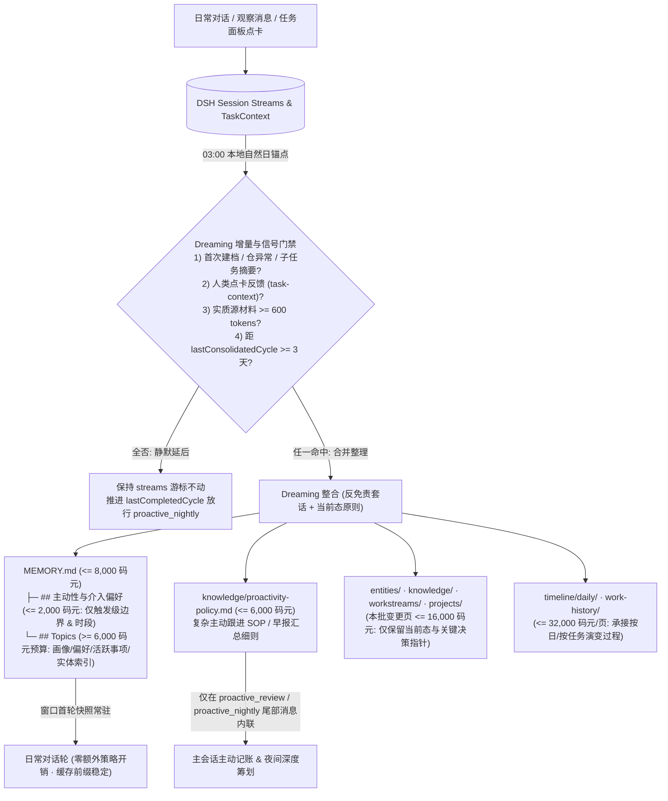

# feat-822: 文档记忆容量护栏、主动策略解耦与巩固增量门禁 — 技术方案

> 对齐: [spec.md](spec.md)

## Changelog

## 现状分析

### 涉及范围

| 落点 | 当前职责与本次改动 |
| --- | --- |
| `packages/product-contracts/src/knowledge.ts` 及单测 | 声明 `KnowledgeConfiguration` 与 `DEFAULT_DREAMING_SCHEDULE`（当前为 `{ nightlyHour: 3, intervalMs: 86400000, quietMs: 1800000 }`）。本次在 `KnowledgeConfiguration['dreaming']` 新增可选 `minSourceTokens?: number`（`>= 0`）与 `maxDeferDays?: number`（整数 `>= 1`），`DEFAULT_DREAMING_SCHEDULE` 补充 `minSourceTokens: 600`、`maxDeferDays: 3`，`normalizeKnowledge` 校验合法数值且不向缺省配置注入冗余键（保证 `canonicalAgentConfiguration` 指纹零漂移） |
| `packages/dsh-integration/src/knowledge/memory-documents.ts` 及单测 | 管理 `.nanoassistant/memory` 物理/结构/链接校验。当前仅限制 `MEMORY.md <= 8,000` 与 `knowledge/proactivity-signals.md <= 4,000`，对 `MEMORY.md` 内的 `## 主动性与介入偏好` 章节无上限、对二级主题页无任何容量护栏。本次：① 新增 `proactiveEntrySectionLimit = 2000`（UTF-16 码元），在 `consolidationIssues` 基于 Markdown AST 偏移校验 `## 主动性与介入偏好`（或英文标题）章节总长度 `<= 2,000`，确保 `## Topics` 恒定保有 `>= 6,000` 码元（`75%`）容量；② 新增可选已确认主动策略文件 `knowledge/proactivity-policy.md`（仅允许 `personal` 与 `global_expert` 存在，上限 `proactivityPolicyLimit = 6000` 码元，允许 `MEMORY.md` 正常链接，供主动唤醒轮按需附带）；③ 新增非历史主题页硬上限 `topicPageLimit = 16000` 码元（作用于 `entities/`、`knowledge/`［不含上述两份专用小文件］、`workstreams/`、`projects/`）与历史单页安全上限 `historyPageLimit = 32000` 码元（作用于 `timeline/`、`work-history/`），在 `consolidationIssues(beforeVersions)` 中仅对本批新增或修改的页面（直接无参调用时检查全库）执行页面上限校验，确保历史超长旧档既不在空闲夜误触发重写，也不会阻塞无关主题的夜间整合，一旦本批触及该页即须精简为当前态并将流水历史沉入 `timeline/` 或 `work-history/` |
| `packages/dsh-integration/src/knowledge/{document-memory,dreaming-agent,dreaming-prompts,dreaming-state,dreaming}.ts` 与 `packages/dsh-integration/src/index.ts` | 文档记忆注入、主动唤醒尾部附带、`Dreaming` 增量调度与提炼/整合提示词。本次：① `DocumentMemory` 新增 `proactivePolicySnapshot(agent)`（读取有效 `knowledge/proactivity-policy.md`），`index.ts` 在 `proactive_review` 与 `proactive_nightly` 尾部唤醒消息中按需附带 `<updated-formal-memory>`（当窗口启动后 `MEMORY.md` 有更新时）与 `<proactive-policy>`（当存在 `knowledge/proactivity-policy.md` 时），日常普通用户对话零额外注入、系统提示前缀零改写；② 重构 `dreaming-prompts.ts`：严禁将发票/差旅/会议时长等被动业务 SOP 与回复排版风格塞入 `## 主动性与介入偏好`（统一归入 `## Topics` + `knowledge/` 或 `entities/`），明确 `MEMORY.md` 主动专区 `<= 2,000` 码元仅留单行触发级边界/静默时段并将复杂巡检/早报细则下沉至 `knowledge/proactivity-policy.md`，要求二级主题页维护“当前有效状态 + 关键决策指针”（目标 `<= 10,000`、硬限 `16,000` 码元）而非按日期追加流水账，并确立“只写有依据事实、略去无依据猜测、严禁在记忆正文中复读‘不代表发送/预订/付款/部署授权’等系统元规则免责尾巴”；③ `Dreaming` 升级自动夜间最小有效增量与信号门禁：计算本批实质源材料 token（人类消息、`task-context`、跨 Agent/子任务汇报与助手实质回复，剔除 `inbox`/`conversations` 协议包装噪音），当处于自动自然日模式、已完成过首次非空记忆建档、仓库无异常、无待整合子任务摘要、无人类任务面板拍板事件（`selectedPending` 与批次内 `task-context` 均为空）、实质源 token `< minSourceTokens` 且距上次实际巩固周期 `owner.lastConsolidatedCycle` 未满 `maxDeferDays` 天时，不调用模型、保留 `owner.streams` 未消费游标供跨天合并，同时将 `owner.lastCompletedCycle` 推进至当夜槽位（确保 `nightlyStatus.completed === true`，既不引发每秒轮询空转，也不阻塞当夜 `proactive_nightly`），返回 `{ accepted: false, completed: false, reason: 'deferred_below_min_volume' }`；合成 4 轮评测适配器 `NanoMemoryCandidate` 显式保留 `minSourceTokens ?? 0` 以维持单句合成用例原语义 |
| `packages/personal-assistant/src/proactive-coordinator.ts` 与 `packages/personal-assistant/assets/skills/{nano-memory,nano-proactive-care}/SKILL.md` | 主动唤醒引导语与随包内置记忆/主动关怀方法论技能。本次同步更新 `proactive_review` / `proactive_nightly` 唤醒说明（优先参考尾部附带的 `<updated-formal-memory>` 与 `<proactive-policy>`）以及 `nano-memory`、`nano-proactive-care` 的分区配额、`proactivity-policy.md` 分工、主题页当前态约束与去免责套话规范 |

### 既有约束

- **跨包单向依赖与单写者边界（`AGENTS.md` / `SPEC.md`）**：仅 `packages/dsh-integration` 调用 `@deepseek-ai/*` 公开 exports；正式记忆 `.nanoassistant/memory` 仍仅由 `Dreaming` 修改并提交 Git，前台主会话与子任务文件写入守卫不变，`knowledge/proactivity-signals.md` 前台禁读守卫不变。
- **上下文缓存前缀稳定（`NoSilentPrefixRewrite`）**：同一上下文窗口内绝不重写 `systemPrompt`、`nano-document-memory`、`nano-document-memory-entry` 或工具 schema；`proactive_review` 与 `proactive_nightly` 所需的 `<updated-formal-memory>` 和 `<proactive-policy>` 仅通过当轮尾部唤醒消息传入，普通对话轮完全不加载 `proactivity-policy.md`。
- **存量兼容与零配置指纹漂移**：`canonicalAgentConfiguration` 不自动补写缺省 `knowledge.dreaming` 子键；存量工作区中历史遗留的超 `16,000` 码元旧主题页不在无新消息的空闲夜触发 `repositoryIssues()` 空转，也不阻塞未触及该文件的其他批次提交。
- **外发与工具审批安全不降级**：从记忆正文中去除冗余免责套话绝不改变前台系统提示（`Current saved Markdown is durable understanding, not user authorization...`）及 `NanoApproval` 的真实授权校验。

### 可复用能力

| 既有能力 | 决策与理由 |
| --- | --- |
| `MemoryDocuments.consolidationIssues` + `runDreamingAgent` 三次同会话修复与 Git 回滚闭环（`feat-793` / `feat-805`） | **直接复用并扩展规则**。将 `MEMORY.md` 主动专区 `2,000` 码元上限、`proactivity-policy.md` `6,000` 码元上限与本批变更主题页 `16,000` 码元上限纳入同一 `consolidationIssues` 报告，超限时由同一 `Dreaming` 会话原位下沉拆分并重新 `git commit`，无需新增修复机制 |
| `index.ts` `proactive_nightly` 尾部 `<updated-formal-memory>` 注入链路（`feat-785` / `feat-805`） | **复用并扩展至 `<proactive-policy>` 与 `proactive_review`**。沿用尾部唤醒文本内联方式，零工具往返、零缓存前缀破坏 |
| `DreamingOwner` `lastCompletedCycle` 自然日槽位管理（`feat-785`） | **复用并拆分 `lastCompletedCycle` 与 `lastConsolidatedCycle`**。当夜因未满最小增量延后时推进 `lastCompletedCycle`（释放 `nightlyStatus` 并止住定时重入），保留 `lastConsolidatedCycle` 与 `owner.streams` 游标用于计算 `maxDeferDays` 跨天兜底 |

### 相关历史

- **`feat-676`（连续原文文档记忆与 Dreaming）**：确立 `MEMORY.md <= 8,000` 码元、二级目录规范与唯一 Git 写者闭环。
- **`feat-785` / `feat-793` / `feat-805`（PA 与 Global 主动性闭环及双速校准）**：确立凌晨 `03:00` 自然日锚点、`MEMORY.md` 四分栏主动专区与 `knowledge/proactivity-signals.md` 观察池；本单元在不破坏三态角色与多人作用域隔离的前提下，补齐分区配额、主动细则分层、子页上限、反免责套话与低增量攒批门禁。
- **`feat-806`（DolphinBench 评测套件）**：封存了 Morgan `1..753` 轮退化基线（`workstreams/project-mercury.md` `127.9 KB`、`MEMORY.md` 主动区挤占 `Topics`、`227` 次 Dreaming），为本单元提供直接 A/B 验证标尺。

## 五端对齐矩阵

| 平台 | 处置方式 | 受影响范围与理由 | 下游验证投影 |
| --- | --- | --- | --- |
| `Web` | `platform-exempt` | `packages/product-contracts/src/knowledge.ts` 仅新增节点内部 `Dreaming` 增量门禁可选字段（`minSourceTokens`、`maxDeferDays`），Web 前端无 `knowledge.dreaming` 编辑表单或协议消费变化 | `./scripts/docs-check` 与 `scripts/check_platform_parity.py` |
| `Desktop (macOS)` | `platform-exempt` | 记忆容量护栏、主动策略文件与 `Dreaming` 门禁均位于节点运行时与助手包内部，桌面壳层无变更 | `./scripts/docs-check` 与 `scripts/check_platform_parity.py` |
| `Desktop (Windows)` | `platform-exempt` | 同 macOS，Windows 桌面壳层与打包脚本无变更 | `./scripts/docs-check` 与 `scripts/check_platform_parity.py` |
| `iOS` | `platform-exempt` | 原生 iOS 客户端不直接消费节点 `knowledge.dreaming` 内部阈值或本地 `.nanoassistant/memory` 文件结构 | `./scripts/docs-check` 与 `scripts/check_platform_parity.py` |
| `Node (macOS / Windows / Linux)` | `shared` | 节点运行时通过工作区共享包 `@nano/product-contracts`、`@nano/personal-assistant` 与 `@nano/dsh-integration` 自动获得新容量护栏、主动策略尾部注入与增量门禁，`apps/node/src` 无需单独分叉代码 | `packages/dsh-integration` 与 `packages/personal-assistant` 单测/集成测试 + DolphinBench 前缀实跑验证 |

## 架构总览



- **Before**：`MEMORY.md` 中 `## 主动性与介入偏好` 无上限且提示词禁止裁剪它，被动业务 SOP 与重复免责套话涌入后吃掉 >70% 首页容量，挤掉核心 `Topics`；二级主题页无容量限制且每轮全页读取追加，单页膨胀至 `128 KB` 流水账；1–2 句寒暄或简单查询的日期每晚照常跑完整 `Dreaming` 循环。
- **After**：`MEMORY.md` 主动专区硬限 `<= 2,000` 码元（仅放主动唤醒触发边界与静默时段），被动业务规则回归 `Topics` 与知识页，复杂主动巡检细则下沉至 `knowledge/proactivity-policy.md` 并仅在主动唤醒尾部按需注入；二级主题页硬限 `<= 16,000` 码元并强制原地维护当前有效状态；记忆正文彻底杜绝元规则免责尾巴；低信息量普通短对话日静默延后攒批（上限 `3` 天兜底且不卡 `proactive_nightly`），重要信号与高信息量对话当夜即时整理。

## 关键决策

1. **采用「`MEMORY.md` 主动专区 `<= 2,000` 码元硬配额 + 可选 `knowledge/proactivity-policy.md`（`<= 6,000` 码元）主动唤醒尾部按需注入」双层结构，严格保持主会话缓存前缀不变。**
   - **理由**：日常普通对话与 10 分钟观察唤醒仍可零延迟从常驻 `MEMORY.md` 读到简短免打扰禁区与触发指针，同时保证 `## Topics` 至少拥有 `6,000` 码元常驻空间；而跨条件主动跟进细则与早报组织规则只在 `proactive_review` / `proactive_nightly` 真正需要时随尾部唤醒消息注入，既不污染日常窗口也不重写 `systemPrompt` 前缀。
   - **拒绝备选**：把整个 `## 主动性与介入偏好` 从 `MEMORY.md` 彻底删除（会导致日常观察流唤醒在未加载额外文件时丢失免打扰禁区与积极盯紧线索，破坏 `feat-805` 契约）。

2. **对二级主题页实施「本批触及页 `<= 16,000` 码元硬上限 + 历史页 `<= 32,000` 码元上限」，不在 `repositoryIssues` 对存量旧页触发空闲强制重写。**
   - **理由**：`16,000` UTF-16 码元（约 4,000–5,000 词结构化当前态摘要）足以完整承载单个重点项目或实体的现行状态、约束与历史链接，同时彻底阻断 `100+ KB` 编年体膨胀；通过比较 `manifest.versions` 仅拦截本批新建或修改的超限页面，保证升级前已有大文件的存量工作区既不会在半夜无增量时自激空跑，也不会因未触及的旧大文件卡死其他主题的正常提交。
   - **拒绝备选**：全库无条件拦截所有存量旧页面（一处历史大文件会阻塞无关对话批次并消耗 3 次修复配额导致回滚）。

3. **在 `Dreaming` 内部拆分 `lastCompletedCycle`（当夜槽位已检查）与 `lastConsolidatedCycle`（上次实际整理槽位），实现零空转、不阻塞 `proactive_nightly` 的最小增量攒批门禁。**
   - **理由**：当夜实质源材料 `< 600` tokens 且无优先信号时，保持 `owner.streams` 游标不推进（确保短对话留在未整理流中与后续天合并），同时将 `lastCompletedCycle` 记为当夜自然日槽位：每秒定时器见到当夜槽位已检查不再空转，`index.ts` 的 `nightlyStatus.completed` 为 `true` 直接放行 `proactive_nightly`；而当后续某晚距 `lastConsolidatedCycle` 满 `maxDeferDays`（默认 `3` 天）时，即便期间再无新消息也会自动兜底消化积压游标，杜绝孤立短消息永久滞留。
   - **拒绝备选**：延后时不更新 `lastCompletedCycle`（会导致 `Dreaming.tick` 每秒重复冻结源流，且将 `proactive_nightly` 阻塞至凌晨 `06:00` 超时）。

4. **在提炼与整合双阶段明确禁止写入系统元规则免责套话，区分“证据审慎判定”与“正文冗余免责”。**
   - **理由**：过去提示词反复强调“偏好不代表发送/付款/预订授权”，导致模型将其当作必填后缀写进每条记忆；改为明确指示“授权由前台运行时与审批器强制执行，记忆正文只陈述有依据的事实、适用范围及用户亲自说出的禁令，略去未证实推断，禁止在条目后附加通用无权限免责声明”，在不削弱任何权限安全的前提下回收 30%–40% 的有效信息密度。

## 接口与数据流

### Context Engineering 分析（Consumer & Lifecycle）

1. **前台主会话（日常对话与观察唤醒）**：
   - **可见变化**：`systemPrompt` 结构与窗口首轮 `MEMORY.md` 快照机制完全不变；因 `## 主动性与介入偏好` 限制在 `<= 2,000` 码元且剔除了被动 SOP 与免责尾巴，`MEMORY.md` 中 `## Topics` 的实体、项目与偏好索引覆盖率大幅提升；前台需要读取详细主动策略时亦可通过普通 `read` 访问 `knowledge/proactivity-policy.md`（但仍严禁访问 `knowledge/proactivity-signals.md`）。
2. **主会话主动唤醒（`proactive_review` 与 `proactive_nightly`）**：
   - **交付时点与格式**：在 `packages/dsh-integration/src/index.ts` 受理 `proactive_review` 或 `proactive_nightly` 唤醒时，若窗口启动后 `MEMORY.md` 发生了更新则注入 `<updated-formal-memory complete="true|preview">...</updated-formal-memory>`；若 `knowledge/proactivity-policy.md` 存在且非空，紧随其后注入 `<proactive-policy>\n...\n</proactive-policy>`。两者均位于当轮尾部系统唤醒消息内，不改变窗口前缀缓存。
3. **后台 `Dreaming` 整合会话**：
   - **首轮输入**：除内联 `MEMORY.md` 与（若存在）`knowledge/proactivity-signals.md` 外，若已存在 `knowledge/proactivity-policy.md` 亦内联其当前正文（计入首轮 70% 容量预算），避免盲改覆盖既有主动细则。
   - **完成校验**：`consolidationIssues(manifest.versions)` 返回具体违规路径与码元计数（如 `MEMORY.md` 主动专区超 `2,000` 码元、`knowledge/proactivity-policy.md` 超 `6,000` 码元、本批修改的 `workstreams/foo.md` 超 `16,000` 码元），引导模型在同一会话内完成精简拆分与二次提交。

### 核心数据结构与门禁计算

- `KnowledgeConfiguration['dreaming']`（`packages/product-contracts/src/knowledge.ts`）：
  ```ts
  dreaming?: {
    nightlyHour?: number;
    intervalMs?: number;
    quietMs?: number;
    maxInputTokens?: number;
    minSourceTokens?: number;
    maxDeferDays?: number;
  };
  ```
- `DreamingOwner`（`packages/dsh-integration/src/knowledge/dreaming-state.ts`）：
  - 新增可选 `lastConsolidatedCycle?: string`（`YYYY-MM-DD` 自然日槽位；初始化时回退 `lastCompletedCycle`，每次实际执行模型整合并完成或确认初始空库无增量时同步更新；因 `deferred_below_min_volume` 延后时仅更新 `lastCompletedCycle`，保留 `lastConsolidatedCycle` 不变）。
- `substantiveSourceTokens(units)`（`packages/dsh-integration/src/knowledge/dreaming.ts`）：
  - 统计 `batch.units` 中人类直接输入、`inbox(action="read")` 返回的实际消息文本、`task-context` 事件、跨 Agent/子任务投递及主 Agent 文本回复的估算 token 总和（忽略 `inbox(action="check")` 空壳与工具调用元数据噪音），与 `minSourceTokens`（默认 `600`）比较。

## 本次审查安排

| 审查编组 | 必须回答的问题 / 对应目标 | 能力与使用阶段 | 证据方法、范围与共享定位 |
| --- | --- | --- | --- |
| 编组 1：代码、契约与 Context 联合审查 | 1) 分区配额、子页容量护栏、`proactivity-policy.md` 权限与尾部注入、增量攒批门禁及 `lastCompletedCycle`/`lastConsolidatedCycle` 状态机是否正确且无死锁；2) 提示词与技能改写是否语义自洽、保缓存前缀且在真实 DolphinBench 前缀运行中消除页面膨胀与免责套话 | `change-code-review` + `agent-context-review`（实施完成后单次联合独立审查） | 完整分支 diff + 确定性单测/集成测试输出 + DolphinBench Morgan 真实模型运行产出的 `MEMORY.md`、子页体积分布与出站请求轨迹原件 |

## 契约层增量 (delta-spec)

- `gateway`：
  - `docs/changes/feat-822-memory-capacity-and-gating/specs/gateway/agent-capabilities.md`（镜像 `docs/specs/gateway/agent-capabilities.md`：更新常驻首页主动专区配额、`knowledge/proactivity-policy.md`、二级主题页容量护栏、去免责套话及自动 `Dreaming` 最小有效增量与兜底天数门禁）；
  - `docs/changes/feat-822-memory-capacity-and-gating/specs/gateway/personal-agent.md`（镜像 `docs/specs/gateway/personal-agent.md`：同步主动唤醒尾部按需附带 `<updated-formal-memory>` 与 `<proactive-policy>` 及低增量延后放行 `proactive_nightly`）；
  - `docs/changes/feat-822-memory-capacity-and-gating/specs/gateway/global-agent.md`（镜像 `docs/specs/gateway/global-agent.md`：同步全局数字员工两阶段主动唤醒对 `<updated-formal-memory>` 与 `<proactive-policy>` 的消费及夜间放行语义）。
- `im`：`no spec delta`（不涉及 IM 服务端接口、数据库或客户端展示契约）。

## 风险与回退

- **风险 1：存量超长页面在首次被触及时需要拆分精简，若模型单次未减到位可能触发修复重试**。
  - **缓解**：提示词给出明确的目标体积（`<= 10,000` 码元）与硬上限（`16,000` 码元）及迁移步骤（先将历史阶段摘要写入 `timeline/daily/` 或 `work-history/`，再精简主题页为当前态），且宿主保留最多 3 次带精确当前字符数的修复反馈与失败回滚保护。
- **风险 2：单条简短但重要的用户偏好在低交互期最多延后 `maxDeferDays`（默认 3 天）进入正式记忆库**。
  - **缓解**：同一上下文窗口内主会话已直接持有原对话并立即遵守；若用户显式要求“记住/现在整理”走手动 `memory_maintenance` 立即执行；初始空白记忆首日建档与任务面板点卡信号均零延迟旁路直通；最长 3 天必兜底落盘。
- **回滚方案**：所有变更向后兼容标准 Markdown 记忆仓（`knowledge/proactivity-policy.md` 属于既有合法 `knowledge/` 一级目录下的常规 `.md` 文件），回退代码提交即可恢复原行为，无需数据回滚脚本。

## 一次性部署迁移

无。

## Runbook for Reviewer

| 服务 | 停止命令 | 启动命令 | 健康检查 |
| --- | --- | --- | --- |
| 无常驻服务 | 无 | 无 | 无 |

**Review 驱动方式**：通过隔离运行时集成测试（`vitest` 启动真实 DSH 子进程验证配额自愈、子页上限、`<proactive-policy>` 尾部注入与 `minSourceTokens`/`maxDeferDays` 跨日状态机）以及真实模型 DolphinBench Morgan 前缀对比运行留存的记忆仓与请求日志核验代码与实际 Context 效果，无需起 Web/IM 常驻服务栈。

**验收前置**：本地模型网关 `http://127.0.0.1:4000` 与 `~/.cache/nano-evals/dolphinbench` 数据集（本机已就绪，用于前缀与全量对比实跑）。

## Milestones

| ID | 标题 | 依赖 | 并行组 | 范围 | 退出标准 |
| --- | --- | --- | --- | --- | --- |
| `M1` | 文档记忆分区配额、子页容量护栏、去套话提示词与巩固增量门禁 | 无 | `G1` | `packages/product-contracts/src/knowledge.ts`、`packages/dsh-integration/src/{index.ts,evaluation.ts,knowledge/*}`、`packages/personal-assistant/{src/proactive-coordinator.ts,assets/skills/*}` 及对应测试与契约归并 | `[reviewer]` 常驻首页主动专区不挤占主题索引、主动唤醒自动获得策略细则且不破坏日常前缀缓存、主题页保持容量上限内当前态、记忆正文无冗余无权限免责套话、低增量短对话日静默攒批且满阈值/兜底天数/明确信号正常巩固；`[worker]` 新增及存量 `dsh-integration`/`personal-assistant`/`product-contracts` 测试、`pnpm build && pnpm typecheck`、`pytest -m "not e2e"`、`./scripts/docs-check` 与 `check_platform_parity.py` 全部通过，且完成 DolphinBench Morgan 前缀实跑对比验证 |
