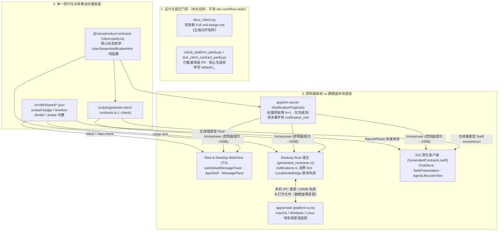
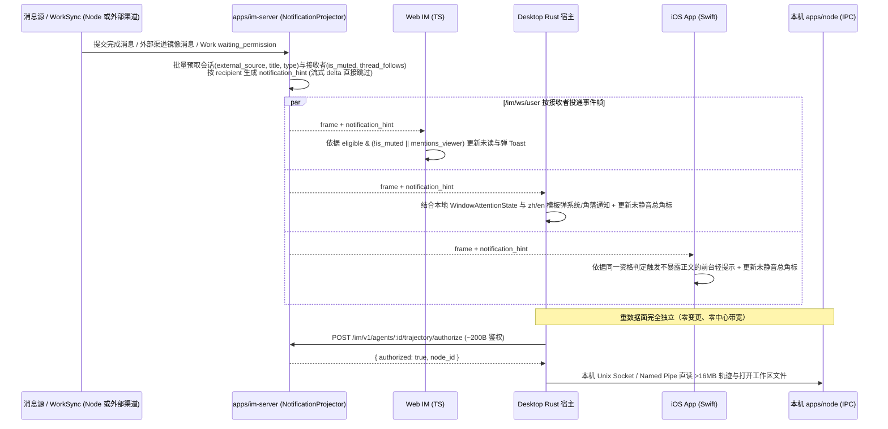

# refactor-800: 五端体验与行为一致性防漏体系 — 技术方案

> 对齐: [motivation.md](motivation.md) v1

## Changelog

## 现状分析

### 涉及范围

- **本仓流程文档与静态对称门禁**：[`docs/development/change-workflow.md`](../../development/change-workflow.md)、[`docs/development/frontend-experience.md`](../../development/frontend-experience.md)、[`scripts/docs_check.py`](../../../scripts/docs_check.py)，以及新增 `scripts/check_platform_parity.py` 与 `tests/contract/test_client_contract_parity.py`。负责在本仓内部校验设计阶段的《五端对齐矩阵》声明、PR 跨端修改对称性与客户端协议枚举穷尽处理，完全不修改外部通用独立库 `dev-workflow-skills`。
- **CI 快慢分层与三系统窄测试接线**：[`.github/workflows/ci.yml`](../../../.github/workflows/ci.yml)、[`.github/workflows/desktop-candidate.yml`](../../../.github/workflows/desktop-candidate.yml) 与 [`src/IM/ios/scripts/build.sh`](../../../src/IM/ios/scripts/build.sh)。负责将共享契约/向量变更接入并行快速 `NanoIMTests` 门禁、拆分重型 `NanoIMUITests` 与近 5 分钟的二次 `Release device archive`，并在 Linux / macOS / Windows 并行任务挂载节点系统适配窄测试。
- **单一契约源与跨语言生成底座**：[`packages/product-contracts`](../../../packages/product-contracts/package.json)（新增 `src/client-parity.ts` 并在 `src/index.ts` 重导出）、新增 `scripts/generate-client-contracts.ts`（支持 `--check`），向 iOS 生成 `src/IM/ios/NanoIM/Client/GeneratedContracts.swift` 并向 Desktop 宿主生成 `apps/desktop/src/generated_contracts.rs`。
- **控制面通知收拢与先行样板（核实发现 4 处真实跨端漂移）**：
  1. **Work 待决权限通知失配**：[`apps/im-server/src/work.ts`](../../../apps/im-server/src/work.ts) `notifyUpdated()` 发出的 `agent.work.updated` 载荷仅含 `{ agent_id, revision }`，而 [`apps/desktop/src/notifications.rs`](../../../apps/desktop/src/notifications.rs) 却读取不存在的 `payload["status"] / payload["main_execution"] == "waiting_permission"`，导致真实服务端下 Desktop 的助手 Work 待决权限通知无法触发。
  2. **外部渠道镜像消息漏提醒与重复拉取**：飞书与微信外部会话入站消息持久化时 `sender_user_id` 为账号 owner（见 `apps/im-server/src/message-records.ts`）；Web [`use-global-message-toast.ts`](../../../src/IM/frontend/src/features/chat/hooks/use-global-message-toast.ts) 靠 50 余行异步重拉会话表判断 `external_source`，而 Desktop [`notifications.rs`](../../../apps/desktop/src/notifications.rs) 与 iOS [`ChatStore.swift`](../../../src/IM/ios/NanoIM/Features/Chat/ChatStore.swift) 直接因 `sender_user_id == self_user_id` 静默丢弃了全部外部渠道入站人类消息提醒。
  3. **会话静音与全局未读角标三端打架**：Desktop [`notifications.rs`](../../../apps/desktop/src/notifications.rs) 全局角标排除 `is_muted` 会话且允许 `@提及` 穿透静音提醒；Web [`app-shell.tsx`](../../../src/IM/frontend/src/app/shell/app-shell.tsx) 与 iOS [`NanoIMApp.swift`](../../../src/IM/ios/NanoIM/App/NanoIMApp.swift) 全局角标直接累加了静音会话，且 Web `use-global-message-toast.ts` 未过滤静音会话普通消息、iOS `ChatStore.swift` 未放行静音群内的明确 `@提及`。
  4. **时间分隔与枚举裸字符串兜底**：Web [`message-pane.tsx`](../../../src/IM/frontend/src/features/chat/components/message-pane.tsx) 使用依赖宿主本地时区的 `Date.toDateString()`，iOS [`ChatModels.swift`](../../../src/IM/ios/NanoIM/Features/Chat/ChatModels.swift) 使用注入 `Calendar`；同时 iOS [`TaskPresentation.swift`](../../../src/IM/ios/NanoIM/Features/Tasks/TaskPresentation.swift) 与 [`AgentLifecycleView.swift`](../../../src/IM/ios/NanoIM/Features/Agents/AgentLifecycleView.swift) 将共享 9 状态任务与 5 状态生命周期声明为裸 `String` 并带 `default:` 兜底。
- **跨端共享黄金测试向量与依赖契约**：扩展 `src/IM/shared/` 新增 `unread-badge-test-cases.json` 与 `timeline-divider-test-cases.json`，并更新 [`tests/contract/test_runtime_dependency_contract.py`](../../../tests/contract/test_runtime_dependency_contract.py) 放行 `src/IM/shared/*.json` 纯静态数据读取（继续禁止跨包可执行代码相对导入）。
- **本机节点跨 OS 原语收口**：[`apps/node/src/lifecycle.ts`](../../../apps/node/src/lifecycle.ts) 及同目录平台调用点，新增 `apps/node/src/platform-io.ts` 与 `apps/node/tests/platform-conformance.test.ts`。

### 既有约束

- **跨包依赖与运行时红线**：遵循 [`SPEC.md`](../../../SPEC.md) 与 [`tests/contract/test_runtime_dependency_contract.py`](../../../tests/contract/test_runtime_dependency_contract.py)，`src/IM/frontend`、`apps/desktop`、`apps/im-server` 与 `apps/node` 仅通过 `@nano/product-contracts` 共享与运行时无关的产品类型与纯函数；iOS 与 Rust 宿主不引入运行时 JS 引擎跑普通聊天列表逻辑，通过生成的原生类型与 `src/IM/shared/*.json` 数据向量对齐。
- **通用技能库解耦红线**：严禁修改外部独立库 `dev-workflow-skills`；所有五端声明与门禁只落在本仓文档、脚本与工作流中。
- **控制面零 N+1 查询与数据面直连不退化**：`apps/im-server` 计算通知提示时不得对每个接收者或每条回放事件发起单行 SQLite 查询，且 `message.delta`、`thinking.segment`、`tool_call.*`、`reply_process.*`、`run.heartbeat` 等高频流式/过程帧绝不附带通知元数据；Desktop 查看本机节点原生轨迹（`LocalNodeBridge`）与打开本机工作区文件的数据面路径保持零改动。
- **向后兼容与离线确定性测试**：新旧服务端与独立客户端分开升级须保持 JSON 线上兼容；当单元测试手工构造不含 `notification_hint` 的最小 `UserEvent` 固件（如现有 `ChatStateTests.swift`、`use-global-message-toast.test.tsx`、`notifications.rs` 单测）时，客户端本地降级分支须继续保持既有行为通过。
- **无 Agent Context 变更与无新增视觉布局**：本 unit 不修改任何模型可见提示词、工具定义、Skill 或上下文恢复逻辑，亦不新增独立页面或视觉控件，无需生成 `prototype.html`。

### 可复用能力

- **直接复用**：
  - [`scripts/generate-ios-interactive.ts`](../../../scripts/generate-ios-interactive.ts) 已在 `package.json`（`check:ios-runtime`）与 `CI -> backend` 建立 `tsx ... --check` 零漂移校验模式，`generate-client-contracts.ts` 直接沿用同一范式。
  - `src/IM/shared/avatar-test-cases.json` 与 [`AvatarTests.swift`](../../../src/IM/ios/Tests/AvatarTests.swift) 已在 Xcode `NanoIMTests` bundle 打通共享 JSON 测试资源挂载，新增向量文件沿用同一测试资源机制。
  - [`scripts/check_change_unit_archived.py`](../../../scripts/check_change_unit_archived.py) 已实现 PR 分支名 `UNIT_BRANCH` 到 `docs/changes/{,archive/}` 目录的唯一定位，`check_platform_parity.py` 直接复用该解析规则处理“PR 提交时 unit 已移入 `archive/`”的场景。
- **扩展改造**：
  - [`src/IM/ios/scripts/build.sh`](../../../src/IM/ios/scripts/build.sh)：利用 `NanoIM.xcodeproj` 已拆分的 `NanoIMTests` 与 `NanoIMUITests` 两个独立 target，新增 `unit-test`（`-only-testing:NanoIMTests`）与 `ui-test`（`-only-testing:NanoIMUITests`）子命令，并支持 `NANO_IOS_SKIP_WEB_BUILD=1` 避免同一 CI Job 内重复编译前端 bundle。
  - [`apps/im-server/src/gateway.ts`](../../../apps/im-server/src/gateway.ts) 与 [`apps/im-server/src/work.ts`](../../../apps/im-server/src/work.ts)：在 `broadcast` 与 `replay` 出口接入批量预取的无 N+1 `NotificationProjector`，并在 `Work.notifyUpdated` 补齐 `main_execution` 与 `display_name`。

### 相关历史

- **[feat-790](../archive/feat-790-desktop-client/design.md)**：引入 `apps/desktop` Tauri Rust 常驻宿主通知守护与本机轨迹直读，暴露了 Rust 侧重复实现 `/im/ws/user` 通知分类引发的群话题、外部镜像与 `agent.work.updated` 字段漂移。
- **[refactor-783](../archive/refactor-783-shared-rpc-contracts/motivation.md)**：将 IM ↔ Node 与 PA ↔ integration RPC 收敛至 `@nano/product-contracts` 穷举契约；本 unit 将这一单源穷举思想延伸至跨语言客户端（TS / Swift / Rust）与多平台 CI 门禁。

## 架构总览

本方案在不增加常规 PR 等待时间、不触碰本地重数据直连通道的前提下，建立从「设计声明 → 跨语言代码生成 → 服务端控制面计算 + 本地共享向量 → 分层 CI 快检」的闭环防线：



## 五端对齐矩阵

| 平台 | 处置方式 | 受影响范围与理由 | 下游验证投影 |
|---|---|---|---|
| `Web` | `native-sync` | `src/IM/frontend` 接入 `@nano/product-contracts` 未读汇总、带显式时区的时间分隔计算及 `notification_hint` 静音/`@提及`/外部镜像提醒判定 | M1 `[reviewer]` ①②、`[worker]` ②③ |
| `Desktop (macOS)` | `native-sync` | 主窗口复用 `src/IM/frontend`；`apps/desktop` 接入 `generated_contracts.rs`、`notification_hint` 消费与未读角标黄金向量，保留本机轨迹与文件直读不变；`desktop-candidate.yml` 挂载 `macos-26` 节点窄测试 | M1 `[reviewer]` ①②、`[worker]` ②③④ |
| `Desktop (Windows)` | `native-sync` | 与 macOS 共享 `apps/desktop` Rust 宿主与前端逻辑；`desktop-candidate.yml` 在 `windows-2022` 运行 `cargo test` 与 `apps/node` 平台窄测试 | M1 `[reviewer]` ①③、`[worker]` ②③④ |
| `iOS` | `native-sync` | `src/IM/ios` 接入 `GeneratedContracts.swift`（替换任务/生命周期裸字符串 `default:`）、`notification_hint` 资格判定、全局未读角标排除静音会话及时间分隔黄金向量；拆分 `build.sh unit-test` 快检 | M1 `[reviewer]` ①④、`[worker]` ①②③④ |
| `Node (macOS / Windows / Linux)` | `native-sync` | `apps/node/src/platform-io.ts` 收拢三端目录同步、私有权限、路径包含、启动标识与本地管道原语；Linux 沿用“后台 Node + Web IM”产品边界，不新增桌面 GUI 安装包 | M1 `[reviewer]` ③④、`[worker]` ④ |

## 关键决策

1. **在本仓文档与脚本内闭环实施《五端对齐矩阵》与 PR 对称拦截，保持 `dev-workflow-skills` 零侵入。**
   - *理由*：五端拓扑（Web / Desktop Mac·Win / iOS / Node Mac·Win·Linux）是 Nano 业务仓特有结构。通过在 [`docs/development/change-workflow.md`](../../development/change-workflow.md) 与 [`docs/development/frontend-experience.md`](../../development/frontend-experience.md) 规定五端矩阵格式，并在 [`scripts/docs_check.py`](../../../scripts/docs_check.py)（检查本 unit 起新增/修改的 Full `design.md`，白名单豁免存量未归档历史草稿）与 `scripts/check_platform_parity.py`（结合 [`check_change_unit_archived.py`](../../../scripts/check_change_unit_archived.py) 定位活跃或已归档 unit 文档，拦截修改共享契约/前端业务却漏改受影响端且无显式豁免依据的 PR）执行硬检查，既兼容 PR 归档流程，又不污染通用 skill 仓库。
   - *拒绝备选*：修改 `dev-workflow-skills` 通用模板（违反跨项目通用边界），或仅靠文档口头提醒不加 CI 拦截（Agent 仍会遗忘）。
   - *风险*：纯文档阶段提交或单端小修若被误拦会阻碍开发；因此 `check_platform_parity.py` 对仅含 `docs/**` 的提交仅校验矩阵语法、不要求实现代码已存在，并对无 unit 小修支持 commit/PR 显式 `Platform-Parity-Exempt: <reason>` 声明。

2. **以 `@nano/product-contracts` 单源生成 Swift 与 Rust 强类型契约，并用静态检查禁止已接入枚举使用默认通配兜底。**
   - *理由*：手写镜像模型无法阻止新增枚举值被 `default:` 静默吞掉。新增无外部重依赖的 `scripts/generate-client-contracts.ts`（支持 `--check`），直接从 `packages/product-contracts/src/client-parity.ts` 生成 `GeneratedContracts.swift` 与 `generated_contracts.rs`，覆盖 `TaskStatus`（9 态）、`TaskMode`、`AgentLifecycleObserved`（5 态）、`AgentLifecycleDesired`、`CollaborationScope`、`WorkerRuntime`、`MessageReceiptStatus` 与 `UserNotificationKind`。同时在 `tests/contract/test_client_contract_parity.py` 扫描已接入消费模块，禁止对上述协议枚举写 `default:` 或 `_ =>`（未知线上值统一在反序列化入口显式转换或拒绝，业务渲染分支必须逐项穷举）。
   - *拒绝备选*：引入重型 OpenAPI/Protobuf 全量重构所有存量 REST 接口（改动过大、与在途分支冲突剧烈，违背渐进收敛边界）。
   - *风险*：旧版客户端遇到新服务端未来新增枚举值时若直接解码抛错会影响整页渲染；生成代码通过外层安全解码包装（`UnknownCaseRepresentable`）隔离未知网络值，同时对内部已知枚举 `enum Known` 保持无 `default:` 编译期穷尽检查——兼顾编译期防漏与线上前向兼容。

3. **在 `apps/im-server` 用户事件流出口批量投射 `notification_hint`（控制面），修复 Work 待决权限与外部镜像漏提醒，保持流式帧与本地轨迹零负担。**
   - *理由*：服务端在事件广播时天然掌握会话是否属于外部镜像（`external_source`）、PA 代发身份（`pa_agent_id`）、群话题受众（`thread_notify_user_ids`）、成员可读显示名（消除原始 `<mention>` XML）及各接收者的 `is_muted` 状态。新增 `NotificationProjector`：
     - 对 `message.delta`、`thinking.segment`、`tool_call.*`、`reply_process.*`、`run.heartbeat` 直接 $O(1)$ 跳过；
     - 在 [`Work.notifyUpdated`](../../../apps/im-server/src/work.ts) 补齐一次主键查询获取 `main_execution`、`display_name` 与 `owner_id`，仅在该 Agent 处于 `waiting_permission` 且接收者具备该 Agent 管理权（`owner_id` 匹配）时标记 `work_waiting_permission`；
     - 在 `Gateway.broadcast` 与 `Gateway.replay` 按批次一次性预取涉及会话与接收者的参与者偏好及显示名（单批固定常数次索引查询，零 N+1），为每个接收者生成 `notification_hint`（回放帧带 `replayed: true` 供客户端抑制历史弹窗）。
     - Web、Desktop Rust 与 iOS 优先消费 `notification_hint`（缺失时保留本地降级逻辑兼容存量合成单测），一次性消除四端提醒分叉。
   - *拒绝备选*：让 Desktop Rust 和 iOS 各自在收到消息时发 HTTP 反查会话 `external_source` 与成员列表（增加网络往返且断网竞态复杂）。
   - *风险*：`Gateway.replay` 最多回放 2,000 条事件；通过提前过滤非通知事件并按 `Set<conversationId>` 批量单次查询会话/成员元数据，确保回放延迟在毫秒级。

4. **将全局未读角标汇总与消息时间分隔抽为纯函数 + `src/IM/shared/` 跨语言黄金测试向量，并用 `fast-check` 验证不变量。**
   - *理由*：统一确立“单会话行保留静音会话自身未读计数与静音图标，应用级全局总未读角标（Web 导航栏、Desktop Dock/任务栏/托盘、iOS 底部 `聊天` Tab badge）仅汇总未静音会话未读数”。同时为 Web 时间分隔函数增加显式 `timeZone` 参数（默认当前时区，测试可固定传入如 `Asia/Shanghai` / `UTC`），与 iOS `Calendar` 实现共同消费 `src/IM/shared/timeline-divider-test-cases.json` 与 `src/IM/shared/unread-badge-test-cases.json`；TS 侧使用 `fast-check` 对任意乱序分页合并、系统通知插入与跨日毫秒边界做属性检验。
   - *拒绝备选*：仅在单端各自手写若干示例单测（两侧边界用例不同步，仍会漂移）。
   - *风险*：仓库如果未安装 `fast-check` 会增加锁文件改动；优先检查锁文件已有依赖或使用确定性伪随机属性生成器避免无谓膨胀（若引入开发依赖则同步更新锁文件）。

5. **拆分 iOS CI 三级按需门禁并收拢 `apps/node` 窄系统适配测试，确保常规 PR 零增时且常规 iOS PR 立省近 5 分钟。**
   - *理由*：在 [`src/IM/ios/scripts/build.sh`](../../../src/IM/ios/scripts/build.sh) 拆出 `unit-test`（仅跑 `NanoIMTests`）、`ui-test`（仅跑 `NanoIMUITests`）与 `archive`：
     - 共享契约（`packages/product-contracts/**`）或跨端向量（`src/IM/shared/**`）变更但未改 `src/IM/ios/**` 时，仅触发 `unit-test`（约 2~3 分钟），完全隐藏在 Linux `backend`（~11 分钟）并行窗口内，常规 PR 总墙钟耗时 **+0 秒**；
     - 修改 `src/IM/ios/NanoIM/**` 业务代码时运行 `unit-test` + `ui-test`，跳过耗时 288 秒的二次真机 `Release archive`；
     - `Release archive` 仅在主干 `push` 或修改工程打包配置（`NanoIM.xcodeproj`、`Config/`、`scripts/build.sh`、`ci.yml`）时运行。
     - 同时抽离 `apps/node/src/platform-io.ts` 与 `<10s` 的 `apps/node/tests/platform-conformance.test.ts`，直接挂入现有 Linux `CI` 与 `Desktop client candidates`（`macos-26` + `windows-2022`），不新增额外虚拟机排队。
   - *拒绝备选*：所有契约变更均触发全量 iOS UI 测试 + Release Archive（每次普通 PR 变慢 4~6 分钟）。
   - *风险*：Swift 源码使用了仅模拟器 SDK 存在而真机 SDK 不存在的符号时，跳过 PR `archive` 可能延后暴露；在 `unit-test` 之外保留 `generic/platform=iOS` 轻量无归档类型检查或确保不含 `#if targetEnvironment(simulator)` 误用即可规避，且工程配置变动与主干合并仍保留完整 `archive`。

## 接口与数据流

### 1. 核心流程时序（控制面通知投射与跨端消费 vs 本地数据面直连）

下列时序展示一次消息/待决权限在服务端的单次批量计算如何同时驱动 Web、Desktop 宿主与 iOS 一致响应，同时保持 Desktop 本机轨迹读取完全绕开中心服务：



### 2. 跨语言共享契约与代码生成接口（`packages/product-contracts/src/client-parity.ts`）

```ts
export const AGENT_LIFECYCLE_DESIRED_STATES = ['enabled', 'disabled'] as const;
export type AgentLifecycleDesired = (typeof AGENT_LIFECYCLE_DESIRED_STATES)[number];

export const AGENT_LIFECYCLE_OBSERVED_STATES = [
  'enabling',
  'enabled',
  'stopping',
  'disabled',
  'stop_unconfirmed',
] as const;

export const COLLABORATION_SCOPES = ['team', 'owner_only'] as const;
export const MESSAGE_RECEIPT_STATUSES = ['sent', 'received', 'read'] as const;

export const USER_NOTIFICATION_KINDS = [
  'human_message',
  'mention',
  'agent_message_created',
  'message_completed',
  'permission_pending',
  'work_waiting_permission',
] as const;
export type UserNotificationKind = (typeof USER_NOTIFICATION_KINDS)[number];

export interface UserStreamNotificationHint {
  eligible: boolean;
  replayed?: true;
  kind?: UserNotificationKind;
  dedupe_key: string;
  is_muted: boolean;
  mentions_viewer: boolean;
  conversation_id?: string;
  conversation_type?: 'direct' | 'group';
  conversation_title?: string;
  thread_root_message_id?: string;
  agent_id?: string;
  sender_name?: string;
  preview_text?: string;
  has_interactive_card?: boolean;
  attachment_name?: string;
  tool_name?: string;
  target_route: string;
}
```

- **代码生成器 `scripts/generate-client-contracts.ts`**：
  - 生成 `src/IM/ios/NanoIM/Client/GeneratedContracts.swift`：为每个共享枚举生成 `enum <Name>: String, CaseIterable, Sendable, Equatable`（供业务 `switch` 无 `default:` 穷举），并提供 `WireEnum<Known>` 包装处理未知未来值而不丢失原始字符串；同时生成 `UserStreamNotificationHint: Codable, Sendable, Equatable`。
  - 生成 `apps/desktop/src/generated_contracts.rs`：生成对应的 `pub enum <Name>`、`#[serde(other)]` 边界转换包装与 `pub struct UserStreamNotificationHint`。
  - `package.json` 增加 `"check:client-contracts": "tsx scripts/generate-client-contracts.ts --check"`，并在 `CI -> backend` 执行。

### 3. 跨端共享纯函数与黄金向量（`src/IM/shared/`）

1. **`src/IM/shared/unread-badge-test-cases.json`**：
   - 输入：`conversations: Array<{ id: string; unread_count: number; is_muted: boolean; local_unseen?: boolean }>`。
   - 规则：单行未读 `rowUnread = Math.max(0, unread_count, local_unseen ? 1 : 0)`；应用全局未读角标 `badgeTotal = sum(is_muted ? 0 : rowUnread)`。
   - 消费验证：Web（`computeUnreadBadgeTotal` 接入 `app-shell.tsx`）、Desktop Rust（`NotificationCenterState` 接入 `notifications.rs`）、iOS（`Conversation.totalUnreadBadge(in:)` 接入 `NanoIMApp.swift`）三端单测共同加载该 JSON 断言完全一致。
2. **`src/IM/shared/timeline-divider-test-cases.json`**：
   - 输入：`{ timezone: string; items: Array<{ type: 'message' | 'agent_config_changed'; id: string; created_at?: string; is_system_notice?: boolean; before_message_id?: string }> }`；输出：`divider_message_ids: string[]`。
   - 规则：跳过非普通消息（`agent_config_changed` 边界与 `system_notice != null` 消息）且**不重置**前后两条普通消息的时间差基准；首条普通消息、在目标 `timezone` 下本地自然日变化、或与上一条普通消息间隔 `>= 300_000ms` 时输出该消息 `id`（覆盖毫秒小数时间戳、UTC 跨日与东八区/东九区跨日不重合边界）。
   - 消费验证：Web（`timelineDividerMessageIds(items, timeZone)` 接入 `message-pane.tsx`）与 iOS（`ChatTimelinePresentation.timestampMessageIDs` 接入 `TimelineTests.swift`）双端读取同一 JSON 断言一致，并在 TS 单测中补充随机序列属性不变量校验。

### 4. Node 窄系统原语适配层（`apps/node/src/platform-io.ts`）与本仓对称门禁

- **`apps/node/src/platform-io.ts`（并供同仓 Node 工具调用）**：
  - `syncDirectoryIfSupported(path: string): void`：`win32` 安全跳过目录 `fsync`，POSIX 执行打开只读目录描述符并 `fsyncSync` 后关闭。
  - `ensurePrivateDirectory(path: string, windowsAcl?: (dir: string) => Promise<void>): Promise<void>`：统一封装 `0o700` 与 Windows ACL 收敛。
  - `resolveLocalIpcEndpoint(rootDir: string, pipeKey: string): { kind: 'pipe' | 'uds'; address: string }`：统一封装 Windows Named Pipe 与 Unix Domain Socket 路径及 `0o600` 权限收敛。
  - `isPathWithinRoot(targetRealPath: string, rootRealPath: string, platform?: NodeJS.Platform): boolean`：统一封装 Windows 大小写不敏感盘符/分隔符边界与 POSIX 路径前缀边界。
  - `readMachineBootToken(deps?): Promise<string>`：统一封装 `darwin` / `win32` / `linux` 启动纪元读取。
- **本仓文档与 PR 门禁**：
  - `scripts/docs_check.py`：新增 `check_platform_parity_matrices()`，对除存量历史未归档草稿白名单外的所有活跃 `docs/changes/<unit>/design.md` 强制校验存在 `## 五端对齐矩阵` 表且包含全部 5 个标准平台行及合法处置枚举（`shared` | `native-sync` | `platform-exempt`）。
  - `scripts/check_platform_parity.py`：在 PR CI 中比对 `BASE_SHA...HEAD_SHA`。若代码改动触及客户端共享契约（`packages/product-contracts/src/{index,chat,chat-codec,task-graphs,agent-lifecycle,collaboration,capabilities,personal-agent,work-events,client-parity}.ts`）、`src/IM/shared/**`、共享 IM 规范或 `src/IM/frontend/src/features/**`（排除纯样式 `.css`、测试文件及纯桌面连接引导 `onboarding/`、`settings/nodes/`），而 `src/IM/ios/**` 无改动，则定位关联 unit 的 `design.md`（活跃或 `archive/`）：仅当 `iOS` 行显式声明 `shared` 或 `platform-exempt`（无 unit 小修则要求显式 `--exempt-reason` 或提交信息 `Platform-Parity-Exempt:`）时放行，否则失败并列出触发文件与待核对端。

## 本次审查安排

| 必须回答的问题 / 对应目标 | 能力与使用阶段 | 证据方法、范围与已有定位 |
|---|---|---|
| 设计是否闭合覆盖首文档四项目标、不侵入 `dev-workflow-skills`、兼容 PR 归档门禁与旧客户端平滑升级 | Gate 2 `change-design-reviewer` | 独立核对 `motivation.md`、`design.md`、3 份 `specs/im/*.md` delta-spec 及生产组装入口（`gateway.ts`、`work.ts`、`notifications.rs`、`ChatStore.swift`、`ci.yml`） |
| 控制面 `NotificationProjector` 是否做到高频流式帧零开销、广播与 2,000 条回放零 N+1 SQL 查询，且不触碰本机轨迹直读数据面；CI 拆分是否不增加常规 PR 墙钟耗时 | 实施自检与 Stage 4 `performance-review` + `change-code-review` | SQLite prepare/query 计数单测断言 100 会话广播与大批量回放查询次数为固定常数；`message.delta` 载荷字节断言零新增字段；核对 `trajectory.ts` / `local-bridge.ts` 零数据面回退及 `ci.yml` 触发矩阵测试 |
| Web、Desktop（macOS / Windows）与 iOS 在通知资格（含静音、`@提及`、群话题关注、飞书/微信外部镜像、Work 待决权限）、未读总角标、时间分隔与无 `default:` 强类型枚举上是否严格一致 | Stage 4 `change-code-review` + 跨端自动化套件验证 | 运行 `pnpm check:client-contracts`、`pnpm test`、前端 `vitest`、`cargo test --manifest-path apps/desktop/Cargo.toml`、`./src/IM/ios/scripts/build.sh unit-test`（`NanoIMTests`）与 `pytest -m "not e2e"` |

## 契约层增量 (delta-spec)

- **IM — Web Chat UX**：修改 [`docs/specs/im/web-chat-ux.md`](../../specs/im/web-chat-ux.md) 的 `Web 应用内新消息提醒按会话类型标识来源`（见 [`specs/im/web-chat-ux.md`](specs/im/web-chat-ux.md)，补充静音会话抑制普通轻提示、`@提及` 提醒、外部镜像入站提醒与导航总未读提示仅汇总未静音会话）。
- **IM — iOS Client**：修改 [`docs/specs/im/ios-client.md`](../../specs/im/ios-client.md) 的 `前台提醒与后台限制明确`（见 [`specs/im/ios-client.md`](specs/im/ios-client.md)，对齐静音会话 `@提及` 提醒、外部渠道镜像入站提醒与底部聊天入口总未读角标排除静音会话）。
- **IM — Desktop Client**：修改 [`docs/specs/im/desktop-client.md`](../../specs/im/desktop-client.md) 的 `Desktop 主窗口保持既有 IM 业务权限、原生通知直达与按服务及账号隔离`（见 [`specs/im/desktop-client.md`](specs/im/desktop-client.md)，明确桌面通知与总未读状态与 Web/iOS 共用统一资格语义，覆盖外部镜像入站、静音与 `@提及` 及本人管理的助手 Work 待决权限通知）。
- **Gateway (`apps/node`)**：`no spec delta`（[`docs/specs/gateway/service-lifecycle.md`](../../specs/gateway/service-lifecycle.md) 既有三端生命周期、自启与重连对外行为完全不变，本次仅收拢内部系统原语模块边界并补齐跨平台契约测试）。

## 风险与回退

- **存量合成测试固件兼容风险**：现有前端、Rust 与 iOS 单元测试中大量手工构造了不含 `notification_hint` 的最小 JSON 事件帧。各客户端消费端均采用“`notification_hint` 存在时以其权威字段为准，缺省时走对齐后的本地纯函数回退”，确保所有存量单测与旧版服务端平滑兼容。
- **PR 对称检查误报风险**：若纯重构或单端局部调整触发 `check_platform_parity.py`，开发者可通过 unit `design.md` 的《五端对齐矩阵》或非 unit 小修的 `Platform-Parity-Exempt:` 明确记录豁免依据放行；若门禁脚本本身出现缺陷，可单独回退脚本接线而不影响任何运行时服务。
- **iOS CI 跳过普通 PR 二次 `Release archive` 的编译差异风险**：`NanoIMTests` 编译整个 `NanoIM` 应用主 target，且涉及工程配置、编译脚本、`ci.yml` 的 PR 及主干 `push` 仍强制执行完整 `Release device archive`，回退只需调整 `ci.yml` 的 `archive_required` 条件。

## 一次性部署迁移

无。本次新增协议字段均为可选增量扩展，无数据库表结构破坏性变更、无本地配置文件迁移。

## Runbook for Reviewer

| 服务 | 停止命令 | 启动命令 | 健康检查 |
|---|---|---|---|
| 隔离验收栈（仅在需手工观察实时 WS `notification_hint` 时按需使用；常规契约与多端黄金向量验证无需常驻服务） | `./scripts/e2e-down.sh --wt "$PWD"` | `./scripts/e2e-up.sh --wt "$PWD"` | `curl -fsS "http://127.0.0.1:$(jq -r .im_port .e2e-runtime/state.json)/healthz"` |

**Review 驱动方式**:
1. 文档、五端矩阵与 PR 对称门禁验证：`./scripts/docs-check && python3 scripts/check_platform_parity.py --self-test && pytest tests/contract/ -q`
2. 单一契约跨语言生成零差异检查：`pnpm check:client-contracts && pnpm build && pnpm typecheck`
3. 后端控制面投射（含零 N+1 查询、外部镜像、Work 待决权限与流式帧零膨胀）与 Node 平台适配验证：`pnpm test`
4. Web 前端共享向量与提醒验证：`npm --prefix src/IM/frontend run test`
5. Desktop Rust 宿主生成契约、通知消费与未读向量验证：`cargo test --manifest-path apps/desktop/Cargo.toml`
6. 原生 iOS 快速契约与共享黄金向量门禁验证（自动选取或创建本机可用模拟器运行 `NanoIMTests`，验证结束后按测试资源回收规范关闭新建模拟器）：`NANO_IOS_SIMULATOR_ID=<udid> ./src/IM/ios/scripts/build.sh unit-test`

**验收前置**: 无（本开发机已具备 Node.js、pnpm、Python 3.12、Rust Cargo 与 Xcode iOS Simulator，全部测试可离线确定性执行）。

## Milestones

| ID | 标题 | 依赖 | 并行组 | 范围 | 退出标准 |
|---|---|---|---|---|---|
| `M1-platform-parity-foundation` | 五端防漏门禁、跨语言生成契约、控制面通知收拢与共享黄金向量闭环 | 无 | G1 | `docs/development/`、`scripts/`、`tests/contract/`、`.github/workflows/`、`packages/product-contracts/`、`src/IM/shared/`、`apps/im-server/`、`apps/desktop/`、`src/IM/frontend/`、`src/IM/ios/`、`apps/node/` | `[reviewer]` ① 同一事件流（普通消息、静音会话、静音 `@提及`、群话题关注/未关注、飞书/微信外部镜像入站、本人管理助手 Work `waiting_permission`）在 Web、Desktop 与 iOS 产生一致的提醒资格与未静音全局总未读角标，单会话行仍保留静音会话自身未读显示；② Desktop 本机原生轨迹与工作区文件直读保持原路径零回退，流式 `message.delta` 无新增字段且广播/回放无 N+1 查询；③ `apps/node` 在各平台保持原有启停、锁与本地管道行为；④ 修改共享契约或前端功能遗漏受影响端且无豁免依据的 diff 被门禁明确阻断，合规声明正常通过，常规 PR 不再为普通改动重复跑全量 iOS Release 真机归档。<br>`[worker]` ① `./scripts/docs-check`、`check_platform_parity.py` 自测（覆盖漏端拦截、归档 unit 识别、文档提交放行与小修豁免）及 `pytest -m "not e2e"` 全绿；② `pnpm check:client-contracts` 零 diff，`GeneratedContracts.swift` 与 `generated_contracts.rs` 接入任务/生命周期/通知类型枚举且 `test_client_contract_parity.py` 确认已接入消费处零 `default:`/`_ =>` 通配兜底；③ `unread-badge-test-cases.json` 与 `timeline-divider-test-cases.json`（含跨时区与 `fast-check` 属性检验）在前端 `vitest`、Desktop `cargo test` 与 iOS `NanoIMTests` 全部实跑通过；④ `ci.yml` 与 `build.sh` 完成三级拆分并在 `desktop-candidate.yml` 挂入 `platform-conformance.test.ts`，回收本轮验证临时模拟器资源。 |
