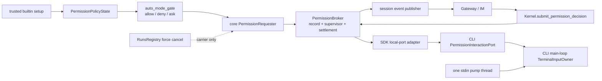

# refactor-476: 收拢权限请求事务所有权 — 技术方案

> Unit branch: `unit/refactor-476` (will be created by orchestrator)
>
> 对齐：motivation.md v5

## Changelog

## 现状分析

### 涉及范围

- `src/agent/core/agent/runtime.py`：`_build_hook_context()` 内构造权限 requester，当前承担
  注册、事件、竞态、liveness 与清理。
- `src/agent/platform/permissions/broker.py`：保存 pending future、run scope、session
  allowlist 与 deny count，并提供 resolve/cancel。
- `src/agent/sdk/kernel.py`：装配 broker，对外提交权限决定，并在 cancel/interrupt 时触发清理。
- `src/agent/platform/hooks/builtins/auto_mode_gate.py`：决定 allow/deny/ask，并通过
  `HookContext.permission_requester` 等待 ask 结果。
- `src/coding_cli/commands.py`、`src/coding_cli/input/`：当前 REPL line reader 与
  permission picker 会各自在 executor 中读取同一 stdin；取消 asyncio task 不能停止已阻塞 picker。
- CLI 与 Gateway/IM：分别是本地 decision adapter 与远端展示/decision adapter，不应拥有
  pending 权威状态。

生产调用链为：

`auto_mode_gate._handle_ask` → `HookContext.request_permission` → engine 内闭包 →
`PermissionBroker.register_request` → session events → 产品展示 →
`Kernel.submit_permission_decision` → broker future。

### 已证实的不变量断裂

1. engine 闭包知道 register-before-publish、heartbeat、local/external race、resolved event 与
   cleanup；broker 同时声称拥有 pending/exactly-once/cancel，并被 engine 直接访问
   `_lock/_pending`。
2. `RunsRegistry.interrupt/cancel` 会强制取消承载 permission await 的 run Task，而 SDK 随后
   才调用 broker cancel；清理若仍在 carrier 的 `finally` 中，负责清理的人会先被杀掉。
3. CLI `_async_main` 在主事件循环运行，kernel/hook/callback 在
   `nano-kernel-executor` thread 的专属事件循环运行；两边不能共享 `asyncio.Event/Future/Queue`。
4. CLI normal prompt 与 permission picker 都能物理读取 stdin。阻塞 reader 被
   `Task.cancel()` 后仍可吞掉下一行。
5. 每次 `build_kernel()` 都新建 broker、executor 与 runs registry，并由返回的 Kernel 持有
   这组 permission/run 资源；但模型目录仍是 module-global `_REGISTRY`，每次 build 会重新初始化，
   后续 run 仍经全局 `provider_of()` 路由。因此本 unit 只能承诺关闭与权限资源的 per-Kernel
   隔离，不能泛化成不同 model catalog 的多个 Kernel 可独立提交。
6. CLI canonical 的非 TTY Requirement 锁定“逐行处理、正常退出、无 ANSI”这一可观察行为，却把
   当前实现函数 `input()` 写进了正文；若输入 owner 改用可停止 fd reader，需要同步把该条改为
   机制中立的完整 MODIFIED delta，而不是制造 design/canonical 双真相。

### 既有约束与可复用能力

- `core` 不得 import `agent.platform`；`platform → core`、`sdk → core + platform`。
- 产品只 import `agent.sdk`，公开符号由精确 allowlist contract 守卫。
- register 必须先于 request event publish；settlement 必须 first-wins；cancel 必须按 run scope。
- permission heartbeat 只覆盖已发布且真实等待的时间。
- **深化**现有 `PermissionBroker`：它已经拥有 pending、dedupe、cancel、deny count 与
  allowlist；不新增同层 coordinator。
- **复用** `HookContext.permission_requester` 作为 core 最窄 ask 端口。
- **复用并深化** pollable raw-key reader 与纯 `_InputState`，组成一个 terminal input owner。
- **删除** engine 内完整 transaction 闭包、broker private access 与 metadata service locator。

### 相关历史

- bugfix-417 与 feat-394 已在 engine 闭包修过 heartbeat、取消和竞态，说明这些规则必须共同拥有。
- refactor-462 已明确 session/run 生命周期；本 unit 只深化 permission 子事务。
- current canonical 已覆盖权限产品行为；本 unit 为新增 SDK extension port、per-Kernel
  permission/run/local-task/executor/finalizer 关闭隔离及机制中立的非 TTY 行输入契约写 delta。
  进程级 model registry 保持现状，不把局部资源所有权扩写成 model catalog 独立性。

## 与 Claude Code 的源码对照

CC 的 `src/hooks/useCanUseTool.tsx` 由一个 transaction owner 串起 policy、queue、abort、
interactive decision、settlement 与 finally cleanup；`src/QueryEngine.ts` 只消费最终结果。
可迁移的是“完整事务只有一个 owner”。

不能照搬的是并发载体。CC 的 `AbortSignal` 与权限 UI 位于同一 JS runtime；Nano 的 broker
supervisor 在 Kernel executor loop，而 CLI terminal owner 在主 loop，另有 physical stdin pump
thread。因此本方案显式增加 loop-neutral future 与 thread-safe dispatch，不把 JS 同 loop 假设
藏进 Python adapter。

## 架构总览



Before：engine 闭包和 broker 分享 transaction 知识，CLI 有两个 stdin reader。
After：broker-owned supervisor 完成从 register 到 result 的事务；carrier 只等待结果；CLI 只有
一个 physical input owner。

## 关键决策

### 决策 1：深化现有 `PermissionBroker`，不新增同层 coordinator

broker 的目标公开能力是 `request(context, permission)`、`resolve(request_id, response)`、
`cancel_run(run_id)` 与 shutdown-only `cancel_all_pending()`。pending、first-wins、run index、
heartbeat、local-interaction abort、resolved publication 与 cleanup 都在同一 transaction record
及 supervisor 内维护。

拒绝“broker 只存 future，另建 transaction service”：两者会共同决定 pop/cancel/settle，继续
共享不变量。删除深化后的 broker 会迫使上述复杂度散回 engine、SDK 与产品，证明它不是假 seam。

### 决策 2：core 只依赖 requester factory 端口

`AgentEngine` 只把 `session_id`、`run_id | None` 与 session event publisher 交给 core-defined
`PermissionRequesterFactory`，得到 `HookContext.permission_requester`。platform 在 SDK
composition 中实现 factory，并绑定 broker 与可选 local decision adapter。

engine 删除 `permission_broker: Any`、`_can_use_tool`、完整 requester 闭包以及
`metadata["permission_broker"]`。factory 缺省时继续使用 `HookContext` 既有 fail-closed 行为。
core 不认识 platform response、policy state 或 broker 私有结构。

### 决策 3：policy state 经 trusted-builtin setup 注入

`PermissionBroker` 实现 platform 内部的窄 `PermissionPolicyState` protocol：只暴露
session allowlist 与 deny-count 的意图化操作。hook loader 接收
`BuiltinHookDependencies(permission_policy_state=broker)`，且只有同时满足
`source == "builtin"` 与 canonical builtin module/path identity 的 `auto_mode_gate` 得到
`setup(hooks, *, permission_policy_state=...)`。

workspace/product hook 即使同名也仍只能调用 `setup(hooks)`；`HookContext` 不增加 service
locator。dependency 为 per-registry instance，不使用 module global；两个 kernel 的 policy
state 不串。

### 决策 4：每个请求先建立 record，再交给独立 supervisor

`PermissionBroker.request()` 在 Kernel executor loop 上执行，且在第一次可取消的 `await` 前：

1. 创建 platform-owned `PermissionTransactionRecord`；
2. 在 broker lock 下登记 `request_id → record` 与 run scope；
3. 创建独立 `asyncio.Task` 执行 `_supervise(record)`，加入 broker-owned `_tasks`；
4. carrier 仅以 `asyncio.shield(asyncio.wrap_future(record.result))` 等待结果。

record 在注册时就持有：

- 创建它的 executor loop；
- thread-safe `concurrent.futures.Future` 形态的 terminal signal 与 result；
- publication/heartbeat/local-interaction 状态；
- local handle 的 abort/exit 能力；
- request/session/run identity。

broker 创建、完成并回收 record、terminal/result future 与 supervisor task；SDK local adapter
创建 interaction cancellation future，并把 legacy callback/new-port task 登记到
**该 Kernel 实例拥有**的 `LocalPermissionTaskRegistry`。每次 `build_kernel()` 新建一份 registry，
只登记该 Kernel local adapter 创建的 task；registry 持有强引用、消费异常并仅在 done callback
中移除。CLI terminal owner 只拥有自己的 main-loop mode future。任何一方都不创建供另一 loop
直接 await 的 `asyncio` primitive。

`resolve`、local result、`cancel_run`、request failure 都进入一个 lock 内 compare-and-set：
只有 `WAITING → SETTLED` 的调用方获胜。线性化时 record 从 external lookup/run index 原子删除并
完成 thread-safe terminal signal；supervisor 已持有 record 引用，可在 lookup 删除后继续清理。
后到 response 一律返回 not-found/False。

### 决策 5：carrier 强制取消不再能杀死 transaction cleanup

supervisor 是 broker-owned sibling Task，不是 run carrier 的 child await；`RunsRegistry`
force-cancel 只命中 carrier。carrier 在 shielded wait 收到 `CancelledError` 时不做异步清理，只
同步调用同一 settle primitive（reason=`carrier_cancelled`）后立即重新抛出。此时：

- 若 external/local/cancel 已先 settle，carrier cancel 是 no-op；
- 若 carrier cancel 先到，它原子删除 pending/run index并唤醒 supervisor；
- local handle 已建立时，supervisor 发出 abort；尚未建立时，supervisor 不再启动它；
- heartbeat、resolved event 和 exit wait 都由 supervisor 完成，不依赖 carrier 的 `finally`。

`Kernel.interrupt(session_id)` 仍先由 `RunsRegistry.interrupt()` 得到实际被强制取消的 active
`run_id`，随后只调用 `broker.cancel_run(run_id)`；carrier 的同步 settle 与 SDK 的精确 run settle
谁先到都使用同一 CAS。`Kernel.cancel(run_id)` 同理。无 active run 不清任何其他 pending；只有
Kernel shutdown 调用 `cancel_all_pending()`。

`Kernel.close()` 与 `Kernel.aclose()` 进入同一个 **Kernel-instance-owned**
`KernelShutdownController`。每次 `build_kernel()` 都把新 controller 与同一次装配产生的
broker、`LocalPermissionTaskRegistry`、RunsRegistry、executor 和 resource finalizer 放进同一
`_KernelComponents` 资源图；shutdown controller 与 local-permission task registry 均不使用
module global（model registry 的进程级共享事实不变）。controller 只在**同一 Kernel** 的
同步/异步关闭入口间共享，用 lock + `concurrent.futures.Future` 只让第一个 caller 执行关闭；
后续 caller 只等待该 Kernel 的同一 future，不重复 stop loop。它把 permission
settle/drain coroutine thread-safely 调度到该 Kernel executor owner loop，并在最后才让该
Kernel 的 RunsRegistry 停 loop。关闭顺序固定为：

1. 关闭 Kernel、RunsRegistry、broker 与 local-task registry 的 admission；
2. settle 全部 permission records，并请求 local interaction abort；
3. cancel/drain queued/running run carriers；
4. 有界 drain broker supervisors，再取消并有界 drain SDK local-task registry；
5. finalize session/resources，最后才停止 executor loop。

`aclose()` 以 `asyncio.to_thread(controller.close)` 等待，不阻塞 consumer loop；`close()` 在
非 executor-owner thread 同步调用同一 controller。同步 `close()` 本来只面向 non-async
consumer；若误从 executor owner thread 调用，必须在改变关闭状态前 fail fast，避免自等待，
而不是静默启动另一套协议。controller 对同一 Kernel 的 concurrent/mixed close 只完成一次，错误
与关闭结果由该实例的同一 future 广播。第一次关闭成功时，所有同时等待及后到 caller 都返回同一
成功终态；第一次关闭失败时，所有同时等待及后到 caller 都重放同一个 primary close failure（同一
类型、消息与 chained diagnostics），不重试 finalizer、不产生新的 secondary failure。executor
owner thread 的非法同步 `close()` 在状态改变前 fail fast，因此不完成/污染 shared close future，
随后从合法线程调用仍可真正执行一次关闭。

关闭 K1 只 seal/cancel/drain K1 的 admission、permission record、local task、run、executor 与
finalizer；K2 对应的 owned graph 不被 K1 的 controller 触碰，其 pending permission 可继续解决，
并可单独关闭。这项隔离不包含 model catalog：当前 model registry 是进程级共享基座，K1/K2
验证使用同一兼容 `LLMConfig`（或不触发 model lookup），只断言本 unit 真正拥有的资源图；不同
catalog 的多 Kernel 独立 submit 明确不在本 unit 范围内。

本地 port abort 后最多等待内部常量
`LOCAL_INTERACTION_EXIT_GRACE_SECONDS = 1.0`。CLI 合规 port 必须在此窗口内恢复 terminal mode
并返回。transaction supervisor 到点后可以完成 record/pending/index/result 与自身清理，但不能
把未退出的 legacy callback/consumer port 宣称为已杀死，也不能从所有 registry 脱离：
`LocalPermissionTaskRegistry` 继续持有它，done callback 消费结果/异常并解除强引用。
shutdown 会 seal registry、对每项再次 cancel，并在共享 1 秒总预算内 drain；仍拒绝合作的 task
记录 request/task identity，随后由 executor loop 的最终 residual-task cancellation/close 处置。
此时只保证 SDK 不再调度该 task、broker state/supervisor 不泄漏；不能承诺强杀 consumer 自行派生
的 thread/process side effect。loop close 后 registry 以明确 `abandoned_on_loop_close` 诊断清空
残余强引用，不伪造正常 exited ack。

### 决策 6：发布、交互和异常的唯一顺序

supervisor 的正常顺序是：

1. register 已完成；
2. 若 terminal 尚未 settle，同步调用 session-event publisher 发布 `permission_request`；
   callable 正常返回是“请求已被本地 EventStreamHub 接受”的线性化点，绝不 `await` publisher；
3. 仅在已发布且仍等待时启动 heartbeat；
4. 仅在仍等待且配置了 local adapter 时建立 local handle；
5. 等待统一 terminal signal；
6. 若 local 没赢，abort local handle 并有界等待 port task 退出；
7. 停止并 drain heartbeat；
8. 仅当 request 已成功发布时发布一次现有 `permission_resolved`；
9. 完成 `record.result`，移除 supervisor task。

具体异常 oracle：

| 情况 | caller 结果 | decision / event trace | heartbeat / local | 最终状态 |
|---|---|---|---|---|
| request publisher 抛错，且无更早 winner | broker requester 重新抛原始异常；生产 `auto_mode_gate._handle_ask` 的既有 catch 将其映射为 `block=true`，ToolRegistry 不执行工具 | request 未被确认发布，不发 resolved | 均不启动 | record/index 删除，无 pending |
| request publisher 抛错，但 cancel 已先 settle | carrier 保持取消；cancel winner 不被覆盖 | request 未被确认发布，不发 resolved | 均不启动 | record/index 删除 |
| local callback/port 抛错且仍在等待 | 保持当前语义：映射为 deny，reason 记录 callback failure | 已有 request；发布 deny resolved | heartbeat 停止；local task退出 | record/index 删除 |
| local callback 在其他 winner 后抛错 | 败者异常只记录 | resolved 使用 first winner | 同上 | 不改变 winner |
| heartbeat publisher 抛错 | 不改变权限等待或决定 | request/resolved 仍按 winner；本 tick 丢弃 | 记录后继续下一 tick，settlement 时停止 | 无泄漏 |
| resolved publisher 抛错 | 已决定的 response 原样返回 | request 已有；resolved failure 只记录 | 已停止/退出 | record/index 仍删除 |
| local exit 超时或 loop closing | cancel/外部 response 原样完成 | resolved 仍按 winner | supervisor 最多等待 1 秒；SDK registry 继续持有 task | pending/index/supervisor 删除；task 仅在 done 或 loop-close abandonment 时移除 |

publisher contract 明确为同步 `(event, data) -> None`：正常返回才算已发布；抛错表示未确认发布，
broker 不猜测其内部是否发生部分副作用。request-publish failure 的真链 oracle 必须走
`ToolRegistry → HookRunner → auto_mode_gate._handle_ask → requester`，证明异常在 hook 内被映射
成 block，而不是落到 HookRunner 的通用 fail-open handler；不得只直测 broker。heartbeat 复用
现有 liveness fail-open 语义，每次 tick 独立。

### 决策 7：新增可选 SDK local-interaction port，保留旧 callback

现有公开别名逐字不变：

```python
CanUseToolFn = Callable[
    [str, Any, Any],
    Awaitable[PermissionDecision],
]
```

第三个参数继续是当前原始 permission request 对象，不替换、不包裹、不增加字段。已有任意外部
application 仍可只传 `build_kernel(can_use_tool=legacy_callback)`；callback 的调用时机、三参数
语义与异常映射保持。发生 external/cancel winner 时，SDK adapter cancel 该 callback task，并按
同一 1 秒 grace 有界等待；不要求 legacy callback 实现新 handshake。task 从创建起到真实 done
始终由 `LocalPermissionTaskRegistry` 持有，transaction 超时不等于 task 已退出。

为 Coding CLI 新增两个 SDK-owned 导出：

```python
class PermissionInteraction:
    request_id: str

    @property
    def cancelled(self) -> bool: ...

    async def wait_cancelled(self) -> None: ...


class PermissionInteractionPort(Protocol):
    async def decide(
        self,
        tool_name: str,
        tool_input: Any,
        request: Any,
        interaction: PermissionInteraction,
    ) -> PermissionDecision: ...
```

`PermissionInteraction.wait_cancelled()` 每次在调用者当前 loop 通过
`asyncio.wrap_future()` 等待 SDK-owned `concurrent.futures.Future`，因此不是 loop-bound。
consumer 无需调用 exit-ack：SDK adapter 在 `decide()` coroutine 返回、抛错或完成取消清理时自动
标记 local handle exited。CLI port 的 coroutine 只有在主 loop terminal mode 已恢复后才返回，
所以“port task exited”就是可验证的退出确认。

`build_kernel(..., permission_interaction_port=None)` 增加一个可选参数。它与
`can_use_tool` 互斥；两者同时非 `None` 立即 `ValueError`，避免两个本地 decision owner。两者都
为空保持 Gateway/IM remote-only 流程。SDK composition 将 public port 包成 platform 内部
`LocalPermissionDecisionPort`；platform/core 不 import SDK，产品也不 import platform。

### 决策 8：CLI 主 loop 是唯一 terminal mode owner

CLI 在 `_async_main`、kernel 装配前创建本次 CLI invocation 拥有的
`CliTerminalInputOwner(main_loop)`；同一 owner 同时服务 normal REPL 与
`PermissionInteractionPort`。thread/loop 归属固定：

- pump thread：唯一调用底层 stdin/raw-key reader；只向 mode-neutral raw buffer 追加 bytes/tokens
  并 `call_soon_threadsafe` 唤醒 main loop，不把物理 read 结果标成 normal 或 permission；
- CLI main loop：唯一修改 normal/permission mode、draft、renderer 与 logical-read demand；
- Kernel executor loop：运行 SDK port adapter 与 broker supervisor，不直接读 stdin；
- `concurrent.futures.Future`：只承担 main loop ↔ executor loop decision/cancel 桥接。

CLI port 的 `decide()` 虽在 executor loop 被调用，但只用
`asyncio.run_coroutine_threadsafe(owner.decide(...), main_loop)` 派发真实交互，再在 executor
loop 以 `asyncio.wrap_future()` 等待结果。interaction cancel future 可由 main-loop coroutine
安全等待；port task 被取消时也 thread-safely cancel bridge future。

owner 维护一个 mode-neutral FIFO buffer 与**至多一个** active logical-read demand。normal prompt
和 permission picker 不各建队列，也不能同时挂 demand。TTY demand 独占消费现有 raw-key state
machine 的 tokens，直到产出 normal line 或 permission decision；下列完整行 claim 规则专门钉死
non-TTY read-ahead。物理 `os.read(4096)` 可以一次预取任意多行，但只把 bytes 追加到 buffer；
完整行属于哪个 mode，不由 read 完成时的 epoch 决定，而由下面的原子 claim 决定：

1. main loop 安装 `NormalLineDemand` 或 `PermissionLineDemand` 时，在短期 threading lock 下更新
   mode + 单调 generation，并立即执行与 source-ready callback 共用的 claim 步骤；该
   main-loop handler 只有看到 active demand 与一个完整行时，才从 FIFO 头取出**恰好一行**并完成
   该 demand。这样 buffer 已提前含多行时，新 demand 不必等待下一次物理 read 才被唤醒；
2. 从 FIFO 移除该行并完成 demand 是 input ownership 的线性化点。若 mode switch/abort 先赢，
   旧 demand 只被撤销，buffer 不变；若 line claim 先赢，该行归旧 demand，不得再重标给新 mode；
3. permission demand 在 claim 一行后立即关闭，任何一次 `os.read` 中剩余的完整行与 partial tail
   都留在 FIFO。permission 决定或 abort 恢复 normal mode 后，下一 `NormalLineDemand` 从同一 FIFO
   继续取下一行；
4. generation 只拒绝旧 demand/control completion，**不得**用于丢弃已缓存但尚未 claim 的 bytes
   或完整行。permission 结束前保存 normal draft，退出后原样恢复；
5. `aclose()` 在同一 lock 下撤销 active demand、seal 新 demand，再停止并有界 join pump；EOF
   先把非空 partial tail 封成最后一行，再把 source terminal marker 排在所有缓存行之后，不越过
   它们。

因此 `prompt\n1\nnext\n/exit\n` 即使一次写入同一个 pipe chunk，也会按逻辑需求依次分给 normal、
permission、normal、normal；permission 不会吞掉 `next`，mode generation 也不会丢弃预取行。
cancel 的线性化点若先于 permission line claim，该行仍留在 FIFO 给恢复后的 normal demand；若
claim 先发生，该行已经是该次 permission 的输入，不会在 cancel 后被二次解释成 normal command。

TTY 复用现有 pollable raw-key reader；non-TTY/test reader 同样只进入这一 pump/buffer，不再为
每次 permission 调用 `input()` 或新 executor reader。真实 stdin 只要有 file descriptor，TTY 与
pipe 都使用带 100ms wake interval 的 `select` + `os.read`，因此 `aclose()` 可设置 stop flag 并
有界 join pump；TTY token 与 non-TTY line 只在 decode 层分流，但共同遵守 single-demand claim。
无 fd 的测试输入改为注入 `TerminalInputSource.poll(timeout) / close()` cooperative protocol，
不能再把不可停止的 `input_fn()` thread 伪装成已取消。

这不会改变 non-TTY 产品行为：decode 层按换行边界顺序产出完整行，EOF 或 `/exit` 能正常结束，
输出仍不含 ANSI。具体 reader/pump 是 CLI 内部 implementation，不进入长青契约；本 unit 同步提供
`specs/cli/spec.md` 的完整 MODIFIED Requirement，删除 canonical 对 `input()` 函数的绑定。

### 决策 9：CLI composition 固定先关闭 Kernel、再关闭 terminal owner

`_async_main` 是 Kernel 与 `CliTerminalInputOwner` 的共同 composition owner。它在 owner 创建后、
Kernel 尚未成功装配时也进入 cleanup scope，并使用嵌套 `finally` 固定关闭协议：

1. 主体退出后先 `await kernel.aclose()`（若 Kernel 已成功创建），此时 terminal owner 仍在运行，
   能消费 broker 发出的 interaction abort、恢复 normal terminal mode 并让 port task 退出；
2. 无论 Kernel 关闭成功还是抛错，外层 cleanup 都继续 `await terminal_owner.aclose()`，递增
   generation、停止并有界 join 唯一 pump；
3. 主体异常保持主异常；仅 cleanup 失败时，Kernel close error 优先传播，owner close error 作为
   chained/diagnostic error 保留；任一 cleanup error 都不能跳过另一个 owner 的关闭。

拒绝先关 terminal owner：它会在 Kernel permission shutdown 尚未发出 abort 前撤走交互 owner，使
local deny/error 与 shutdown cancel 竞速并留下 pump/port 不确定态。也拒绝只让 Kernel 间接关闭
产品 owner：Kernel 是产品中立库，不拥有 CLI terminal。

## 接口与数据流

- core：`PermissionRequesterFactory(context) -> PermissionRequester`；context 仅含
  `session_id`、`run_id | None`、event publisher。
- platform：broker transaction 输入现有 request，返回现有 response；内部
  `PermissionTransactionRecord` / `LocalInteractionHandle` 不导出。
- SDK：既有 `CanUseToolFn` 不变；新增 `PermissionInteraction`、
  `PermissionInteractionPort`、每 Kernel 一份的 local-task registry 与 shutdown controller，
  以及 `build_kernel(permission_interaction_port=...)`。
- external resolve：输入 request id/decision，只有 CAS winner 返回 True。
- cancel：`cancel_run(run_id)` 与 shutdown-only `cancel_all_pending()` 分名。
- CLI：`CliTerminalInputOwner` 只暴露 normal line、permission decision 与 `aclose()`；内部以
  single logical-read demand 从 mode-neutral FIFO 一次 claim 一行，renderer/broker/legacy
  picker 均不能直接读 stdin。
- CLI composition：`_async_main` 持有 Kernel 与 terminal owner；cleanup 固定
  `kernel.aclose()` → `terminal_owner.aclose()`，用嵌套 `finally` 保证两者都执行。

```mermaid
sequenceDiagram
    participant A as CLI _async_main
    participant K as Kernel
    participant C as run carrier
    participant B as PermissionBroker
    participant S as broker supervisor
    participant P as SDK local port
    participant T as CLI main-loop owner
    participant R as RunsRegistry
    C->>B: request(context, permission)
    B->>B: register record + start S
    C->>B: shielded await result
    S-->>P: permission_request event
    S->>P: decide(interaction)
    P->>T: run_coroutine_threadsafe
    par user/local decision
        T-->>P: decision future
        P->>B: settle(local)
    and remote/cancel decision
        R--xC: force-cancel carrier
        C->>B: settle(carrier_cancelled)
    end
    B->>B: CAS winner + remove lookup
    B-->>S: terminal signal
    S-->>T: abort interaction if local lost
    T-->>P: mode restored; port returns
    S-->>P: permission_resolved event
    S->>B: complete result + forget task
    Note over A,T: CLI finally keeps T alive through Kernel shutdown
    A->>K: await kernel.aclose
    K->>B: settle + drain owned permissions
    K-->>A: close completed or raised
    A->>T: await terminal_owner.aclose
    T->>T: stop pump after mode recovery
```

## 契约层增量 (delta-spec)

- kernel: MODIFIED — `specs/kernel/sdk-boundary.md` 完整保留原两条 Requirement/Scenario，
  新增 SDK-owned `PermissionInteraction`、`PermissionInteractionPort` 与互斥的可选 build
  参数；`specs/kernel/runs.md` 完整保留原 callback/interrupt 场景，并加入 legacy callback、
  new port、remote-only、first-wins 与 request publication fail-closed 契约，同时完整
  MODIFIED 既有 Kernel 关闭 Requirement，只锁定每 Kernel
  permission/run/local-task/executor/finalizer 资源隔离。进程级 model registry 与多 catalog
  限制保持现状；Kernel 方法集与正常产品行为不变。
- im: no spec delta。
- gateway: no spec delta。
- cli: MODIFIED — `specs/cli/spec.md` 完整保留非 TTY 的逐行处理、正常退出与无 ANSI Scenario，
  只把 `input()` 实现绑定改为机制中立契约；single-owner/loop bridge 仍是内部 implementation，
  permission 与 Ctrl-C 产品行为保持。

## 风险、验证与回退

- **carrier-cancel 竞态**：barrier 分别放在 register 前、register 后/发布前、publish 返回后、
  heartbeat 启动后、local handle 建立后；每点 interrupt 均断言 terminal mode 恢复、
  heartbeat 停止、目标 run 无 pending、late response=False、同 session 新 run 可启动、其他
  run 不受影响。不得用 sleep。
- **真实双 loop 假阳性**：至少一组测试必须启动真实 `KernelExecutor` thread/loop 与 CLI
  `_async_main` owner loop，TTY 和 non-TTY 各跑一次 cancel→下一输入旅程；non-TTY 另把
  `prompt\n1\nnext\n/exit\n` 一次写入同一 pipe chunk、全程无 sleep，覆盖
  allow/deny/cancel→next-line，断言 permission 恰消费一行且余行 FIFO。broker/fake adapter
  共用单 loop 的测试不能替代。
- **兼容性**：contract 锁定 `CanUseToolFn` 三参数与原始 request identity；分别测试 legacy、
  new port、remote-only，以及两者同时提供的 `ValueError`。
- **异常语义**：以上异常表逐行成为参数化 oracle，检查返回/抛出、event trace、heartbeat/local
  启动、pending/index、supervisor 与 SDK local-task registry；request publisher failure 另经
  真实 ToolRegistry/HookRunner/auto-mode 调用链验证 fail-closed。
- **关闭一致性**：同步 `close()`、异步 `aclose()`、并发/混用关闭分别在 permission pending
  时驱动；断言同一 Kernel 共享一个 finalizer，records/carriers/supervisors/local registry
  按顺序收口，executor loop 最后停止；成功终态向所有 caller 返回，首次失败则向 concurrent 与
  later caller 重放同一 primary failure 且不重跑 finalizer。另用同一兼容 `LLMConfig` 装配
  K1/K2 且各挂一个 local permission，关闭 K1 后 K2 permission/run/task/executor graph 未被
  seal/cancel、K2 决定仍能完成，最后两者各自关闭且各自 executor thread 退出；测试名与断言不得
  暗示不同 model catalog 已 per-Kernel 隔离。
- **CLI composition cleanup**：分别注入主体失败、Kernel close 失败、terminal owner close 失败与
  双 cleanup 失败，断言 Kernel 始终先关、owner 始终随后执行、owner 在 Kernel abort 期间仍可服务，
  且 primary/chained error 不丢。
- **trusted dependency**：两个 Kernel 的 permission policy state 隔离；同名 workspace hook
  negative test 证明拿不到 builtin dependency。
- **分层**：contract 继续禁止 core import platform、产品 import internal，并更新 SDK 精确
  allowlist/ownership。
- **回退**：unit 原子回滚到旧 broker/engine/CLI 组合；不保留双 transaction owner、双 stdin
  reader或双 pending state。既有 `CanUseToolFn` 不属于待删兼容层。

## Runbook for Reviewer

本 unit 修改 kernel 库与两个产品中的权限旅程；端到端验收使用 worktree 隔离 IM + Gateway。

| 服务 | 停止命令 | 启动命令 | 健康检查 |
|---|---|---|---|
| worktree IM + Gateway | `./scripts/e2e-down.sh` | `PATH=/Users/czj/Repos/nano-multiagent/.venv/bin:$PATH ./scripts/e2e-up.sh` | `source .e2e-ports.env && curl -fsS "$IM_URL/openapi.json"` |

**Review 驱动方式**：真栈。CLI 权限真驱动 TTY 与 non-TTY，Gateway 权限真驱动 Web IM 卡片，
分别覆盖 allow、deny、等待时 cancel；CLI 必须证明 cancel 后下一行进入 normal REPL。聚焦并发测试
必须使用真实 Kernel executor loop 与独立 CLI main loop。

**验收前置**：live LLM proxy 是本 unit 的真栈权限旅程硬前置，不能用当前
`scripts/fixtures/` 替代——仓内现有 happy fixture 不产生 `tool_use`。资源来源与可用性检查为：

- `~/.nano-assistant/config.yaml` 可读且含 `llm:`；
- `curl -fsS http://127.0.0.1:4000/health` 返回成功；
- 当前设计环境已在 2026-07-25 验证以上两项可用。

精确验收命令：

```bash
NANO_MULTIAGENT_RUN_LIVE_PROXY_E2E=1 \
PYTHONPATH=src \
.venv/bin/pytest -xvs \
  tests/e2e/critical_paths/test_permission_approval_critical_path.py
```

该测试用真实模型请求 `write` 写隔离 workspace 下的 dangerous basename `.gitconfig`；一旦模型
发出真实 `write` tool call，工具的 hard permission rule 必然进入 ask，approve/deny 分别以文件
副作用存在/不存在为确定性锚。fixture 自动通过 `e2e-up.sh --wt <pytest tmp>` 起停隔离真栈。若
proxy、配置或模型 tool calling 不可用，reviewer 必须把真栈验收标为 blocked，不得以 broker
单测或不会产生 `tool_use` 的文本 ACK fixture 冒充通过。

## Milestones

默认单 M1：事务切换、SDK port 与 single-input owner 必须原子落地；按层拆分会产生双 owner。

| ID | 标题 | 依赖 | 并行组 | 范围 | 退出标准 |
|---|---|---|---|---|---|
| refactor-476-M1 | 权限事务单一所有者切换 | 无 | permission | core requester port、platform broker/supervisor + trusted builtin dependency、SDK cancel/resolve + interaction port、CLI terminal owner/Gateway adapter、kernel/CLI delta-spec、测试 | [reviewer] motivation 全部 Scenario 在真栈保持，CLI cancel 后下一输入未被旧 picker 消费，pipe 一次预取多行时 permission 恰消费一行且余行按 FIFO 进入 normal REPL；[worker] register/publish/heartbeat/local-handle 五个 barrier 的 carrier cancel matrix、异常表全部 oracle、local/external/cancel first-wins、多-Kernel permission policy 隔离均通过，request publisher failure 真链 fail-closed，late response=False且无 pending/supervisor 泄漏；[worker] 既有 `CanUseToolFn` 三参数 identity 兼容、新 port/remote-only/互斥装配 contract 通过，每 Kernel local-task registry 对 done/timeout/loop-close 的强引用与诊断规则通过；[worker] 同一 model catalog 下 K1/K2 permission/run/local-task/executor/finalizer 隔离、`close/aclose` pending-permission、混用/并发/重复关闭共享 per-Kernel finalizer，首次 close failure 对所有 caller 重放且 finalizer 只跑一次，CLI 嵌套 finally 在任一 cleanup 失败时仍按 Kernel→terminal owner 全部执行，真实 KernelExecutor + 独立 CLI loop 的 TTY/non-TTY 测试包含单 pipe chunk 无 sleep 的 allow/deny/cancel→next-line matrix、core/SDK/CLI boundary contract、相关非 e2e pytest 与 ruff 通过 |
