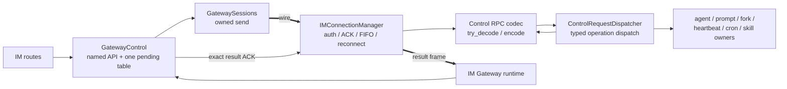
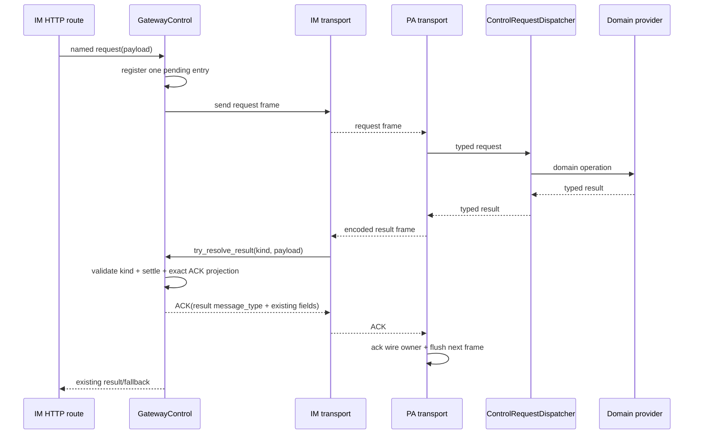

# refactor-478: 深化 IM 与 Gateway 控制 RPC 边界 — 技术方案

> 对齐：motivation.md v1

## Changelog

- v4（2026-07-25）：补齐 11 类 PA request decode 与 IM result schema matrix，恢复 cron
  raw delete 的混合脏行 live parity，并登记 cron HTTP canonical drift。
- v3（2026-07-25）：明确 cron control 走 `CronJobStore` 的 raw-list codec，避免 typed
  scheduler projection丢弃未知字段或改变现有 delete过滤语义。
- v2（2026-07-25）：补齐 11 类且仅 11 类 operation inventory、result ACK/FIFO
  回路、唯一 codec seam、managed-channel 排除、逐 operation failure matrix 与
  heartbeat/cron/skills 领域 owner。

## 现状分析

### 涉及范围

- `src/IM/ws/gateway/control.py`：11 组 waiter map、request 方法、timeout/finally 和
  result resolver。
- `src/IM/ws/gateway/runtime.py`：把 Gateway result frames 分发给对应 resolver，并把
  resolver 返回的 ACK 原栈发回 Gateway。
- `src/personal_assistant/ws/im_connection.py`：连接、注册、ACK、FIFO、重连、close，以及
  全部控制业务分支。
- `src/IM/api/routes/agents.py` 等 routes：控制平面的上游调用者。
- PA 侧已有 agent config、prompt、fork providers，以及当前仍内联在 connection 的
  heartbeat/cron/skills 文件逻辑；后者需要建立真实领域 owner，但不改变结果语义。

以 prompt preview 为例，完整生产调用链是：

`IM HTTP route` → `GatewayControl.request_prompt_preview` →
`GatewaySessions.send` → PA `IMConnectionManager._listen_once` → provider →
`send_json(result)` → IM Gateway runtime → waiter resolver + exact ACK →
PA `_ack_pending_frame()` 释放 wire owner → flush 下一帧；HTTP waiter 与 ACK 回路分别
收敛。

### 既有约束

- refactor-472：`GatewayControl` 是全部 result waiter 的唯一 owner，所有 waiter 共用
  一个锁；拒绝每 RPC 一类。
- refactor-470：`IMConnectionManager` 是 wire、认证、FIFO、ACK、reconnect、close 的
  唯一 owner；关闭动作必须留在同步 await 栈。
- 不引入第二 receive loop、第二发送 queue 或 untyped event bus。
- wire frame、request id、timeout fallback、late/unknown result 与 auth boundary 保持。
- 每个语法有效的 supported result 都必须在 IM 原栈返回当前精确 ACK；PA outbound
  FIFO 只有收到 ACK 中的原始 result `message_type` 才释放 wire owner。
- IM 与 personal_assistant 禁止互相 import，共享语义只能经协议值而不是 Python 类型依赖。

### 可复用能力

- **深化** `GatewayControl`，保留每种 operation 的具名 public method。
- **深化** `IMConnectionManager` 的 transport ownership，但把领域分派委托给一个下游
  dispatcher。
- **用** 已有 provider callables 与 `GatewaySessions.send`。
- **用并深化** `CronJobStore` 作为 cron 文件 owner；通过 compatibility control methods
  固定当前 raw-list/delete 降级语义，不在 dispatcher 复制 JSON IO。
- **不用** 11 套独立 waiter 容器和 `_listen_once` 中的领域 if/elif 链。

### 相关历史

- refactor-470 已移走 channel policy 并确定 transport owner。
- refactor-472 已把 waiter 从 route/handler 收到 `GatewayControl`，本 unit 在该 owner
  内继续消除按 operation 复制的生命周期。
- canonical `docs/specs/im/gateway-relay.md`、`agents-nodes.md` 与
  `docs/specs/gateway/relay-protocol.md` 描述现有边界；其中 skills frame 名存在已知
  canonical/live drift，cron HTTP canonical 仍写 `/cron-jobs`，而生产 route/前端/守护测试
  使用 `/cron/jobs`。本 unit以当前生产 wire/routes 与守护测试为迁移基线，不顺带改名；两项
  canonical repair 另行处理。

## 与 Claude Code 的源码对照

CC 的 `src/bridge/replBridgeTransport.ts` 以窄 transport interface 隔离 v1/v2 连接实现；
`src/bridge/bridgeMessaging.ts` 先做 ingress parse/dedupe/routing，再由 typed
`ServerControlRequestHandlers` 和 `handleServerControlRequest` 处理具体 subtype 与统一响应。

Nano 可复用的是“transport 只拥有连接语义，typed dispatcher 拥有 operation 语义，
correlation lifecycle 集中”。Nano 多一个 IM↔Gateway 远端边界，因此 IM waiter owner 与
逐 result ACK 必须保留，不能照抄 CC 的进程内 handler，也不能让两包共享运行时类。

## 架构总览

Before：相关生命周期按 operation 复制，PA transport 直接执行领域操作。\
After：IM correlation 与 PA transport 仍各有单一 owner，operation registry、typed codec 与
领域分派成为窄下游；ACK 回路仍由 transport owner 同步完成。

## 关键决策

### 决策 1：`GatewayControl` 保留具名 API，内部只用一张 pending table

每个 `request_*` 仍是 routes 可发现、可类型检查的公开方法；它调用同一个
`_request(operation, payload, timeout_policy)`。pending value 保存 expected operation 与
typed future；全部 operation 在同一锁、同一 register-before-send、timeout、finally 清理和
late-result 规则下运行。

拒绝对外暴露 `request("string", dict)`：那会把 frame 名、fallback 与结果类型泄漏给
route，形成浅通用 façade。

### 决策 2：result ingress 同时负责 settlement 与精确 ACK projection

IM Gateway runtime 通过一个稳定入口把 frame 交给
`GatewayControl.try_resolve_result(message_type, payload)`。该入口从同一 operation
registry 找 descriptor，完成 result validation/normalization、expected-operation 检查、
settlement 与 ACK projection，并返回 `AckFrame | NotControlResult`。

owner 只有在 request id 存在且 expected operation 匹配时完成 future；unknown、late 或
mismatched request id 不完成任何 waiter，但只要 result frame 与 payload 语法有效，仍返回
**当前实际 result operation** 的精确 ACK。malformed result 继续沿现有 runtime
`bad_payload`/连接错误路径，不被“unknown result”吞掉，也不返回伪 ACK。

本 unit保持当前 request-id correlation，不顺带加入 node identity 绑定；若要改变
安全/行为语义，应独立 bugfix 与 delta-spec。

### 决策 3：operation registry 是 11 类且仅 11 类相关 RPC

封闭集合精确包含：

1. `agent.config.get` → `agent.config`
2. `agent.create` → `agent.created`
3. `session.fork.request` → `session.fork.result`
4. `node.capabilities.resolve` → `node.capabilities`
5. `agent.capabilities.resolve` → `agent.capabilities`
6. `agent.prompt.preview.request` → `agent.prompt.preview`
7. `node.prompt.preview.request` → `node.prompt.preview`
8. `node.heartbeat.md.request` → `node.heartbeat.md`
9. `node.cron.jobs.request` → `node.cron.jobs`
10. `node.skills.usage.request` → `node.skills.usage`
11. `node.cron.delete.request` → `node.cron.delete`

明确排除 relay、register、ACK/error、`config.sync`、`heartbeat.trigger`、
permission response，以及全部 `channel.*`、bootstrap、reconcile frame。Agent 配置
PATCH 继续是 IM optimistic-lock 本地持久化 + best-effort 单向 `config.sync`；只有 live
read 属于上表相关 RPC。

`ManagedChannelBindings` 继续直接连接 `IMConnectionManager` 与
`ManagedChannelControl`，包括 status result 触发的同步 `close()`，不经过本 dispatcher。

### 决策 4：PA 新增一个同步下游 `ControlRequestDispatcher`

dispatcher 接收一个 typed operation union，调用注入的领域 providers，并返回 typed
result。它不持有 socket、queue、reconnect、ACK cursor 或 background task。

dispatcher 是一个 operation-family owner，而不是每 RPC 一个类；新增 operation 必须在
union、handler 和 contract inventory 中显式登记。

### 决策 5：PA control 模块拥有唯一 codec seam，connection 只有一个稳定分支

PA `gateway/control_rpc.py` 由同一 operation registry 派生 typed union、codec 与 handler
inventory，并暴露固定 seam：

- `try_decode(message_type, payload) -> TypedControlRequest | NotControlRequest`
- `dispatch(request) -> TypedControlResult`
- `encode(result, *, node_id) -> (message_type, payload)`

`IMConnectionManager` 在 transport/managed-channel/单向控制之后只有一个 control-RPC
branch：调用 `try_decode`，若命中则 await dispatch、encode 并用既有 `send_json` 入队；它
不按 operation 读取 payload/result shape。领域 provider 不接触 raw frame 名或 socket；
transport 不读写 heartbeat/cron/skill 文件。

request decode 错误继续从该同步 await 栈抛回 connection 的既有 reconnect/error 处理，
不会被转换成新的 failure frame。`NotControlRequest` 才回到其他既有分支/unsupported
处理，不能用 decode exception 表示“不属于本 dispatcher”。

### 决策 6：heartbeat、cron、skills 各有真实领域 owner

- `HeartbeatDocumentReader`（scheduler/heartbeat domain）拥有
  `<workspace>/HEARTBEAT.md` read；空 workspace、文件不存在或 `OSError` 均返回 `""`。
- `CronControlService`（scheduler domain）通过 `CronJobStore(workspace)` 工作。
  `CronJobStore` 增加 control-compatible `list_for_control()` /
  `delete_for_control(job_id)`，精确保留当前 wire 行为：不存在、非 list、JSON/OSError
  返回 `[]`/`false`；这两个方法走 raw-list codec，不能复用会把 unknown/invalid rows投影成
  `CronJob` 的 `_read_all()`。list原样返回所有 JSON list items。delete 按当前生产的
  `filtered = [dict row whose id != target]` 计算：目标 dict 与所有 non-dict row 都会被过滤；
  只要 `len(filtered) < len(raw_list)` 就写回并在写成功时返回 true。因此“目标不存在但 raw
  list 含 non-dict 脏行”仍会清理脏行并返回 true；完全没有目标或脏行时不写且返回 false。
  保留其余 dict 的未知字段。
  不在 dispatcher 或 connection 另写第二份 `jobs.json` parser。
- `SkillUsageProjection`（gateway domain）接管当前 `_build_skills_usage_payload` 及 helpers；
  缺 workspace、usage 文件不存在/损坏时保持 empty/skip 语义。

这些 owner 以窄 provider 注入 dispatcher；dispatcher 只编排 operation，不承载文件规则。

### 决策 7：保持严格串行、既有失败行为与关闭顺序

`_listen_once` 在收到 control request 后仍在原 await 栈等待 dispatcher，并把 result 交给
既有 outbound FIFO；dispatcher 不用 `create_task` 偷跑业务。PA result 送达 IM 后，
IM runtime 原栈返回 ACK；PA connection 仅在 `_ack_pending_frame()` 验证 ACK
`message_type == result frame type` 后释放 wire owner并 flush 下一帧。close 与
managed-channel status directive 继续由 connection owner 在同步 await 栈完成。

不存在 universal “connection 生成 failure result”。每项 operation 保持下表既有 fallback；
未列为显式空值降级的 provider exception 会让本次 connection 失败/重连，IM waiter最终按
自身 timeout 返回，绝不发明新 frame。

## 接口与数据流

IM operation descriptor 包含：request/result frame、request builder、result
decoder/normalizer、typed future result、timeout/default、ACK projector。descriptor
只供 `GatewayControl` 私有使用，routes 仍调用具名方法。

### PA request decode inventory

`strict` 字段用当前 `_require_text/_require_mapping` 语义：缺失、类型错误或空字符串均抛出，
沿 connection failure/reconnect，IM waiter 最终按既有 timeout 返回。`tolerant` 字段只按表中
规则归一化，不得被 typed DTO 构造器擅自升级为 required；未列字段由对应 typed request 丢弃，
只有 fork 明确 raw passthrough。

| request | strict required | tolerant / filtered / passthrough |
|---|---|---|
| `agent.config.get` | non-empty `request_id`, `agent_id` | 其余忽略 |
| `agent.create` | non-empty `request_id`; object `agent` | `agent` 原 mapping 交 create handler |
| `session.fork.request` | non-empty `request_id` | 除 decode 所需 request id 外，完整 raw body 原样交既有 fork handler；handler result 非 mapping → `{}` |
| `node.capabilities.resolve` | non-empty `request_id` | 其余忽略 |
| `agent.capabilities.resolve` | non-empty `request_id`, `agent_id`, `workspace_root` | 其余忽略 |
| `agent.prompt.preview.request` | non-empty `request_id`, `agent_id`, `workspace_root` | `features`: object else `{}`；`custom_prompt`: string else `None`；`tool_ids`/`skill_ids`: list 时仅保留 string item，else `[]`；`scenario`: string else `"direct"` |
| `node.prompt.preview.request` | non-empty `request_id` | `workspace_root`: string else `""`；其余 preview 字段按上一行归一化；provider 的 agent id 固定 `""` |
| `node.heartbeat.md.request` | non-empty `request_id` | `workspace_root`: string else `""`；不要求/不读取 `agent_id` |
| `node.cron.jobs.request` | non-empty `request_id` | `workspace_root`: string else `""`；不要求/不读取 `agent_id` |
| `node.skills.usage.request` | non-empty `request_id`, `agent_id` | `workspace_root`: string else `""` |
| `node.cron.delete.request` | non-empty `request_id` | `job_id`/`workspace_root`: string else `""`；不要求/不读取 `agent_id` |

### IM operation / ACK inventory

所有 IM named requests 在 node offline、send 返回 false或 timeout 时保持 `None`；默认
timeout 见表。ACK 的 `message_type` 始终是 **result frame**，unknown/late/mismatch 也按
actual result payload 投影同一 ACK。表中 `strict` 字段缺失/类型错/空字符串，或 strict object
不是 object 时属于 malformed result：沿现有 runtime error/connection 路径且不 ACK；tolerant
字段按表归一化后，即使 waiter unknown/late/mismatch 仍返回精确 ACK。

| request → result | timeout | IM result schema / waiter projection | ACK 额外字段（除 `message_type/request_id`） |
|---|---:|---|---|
| `agent.config.get` → `agent.config` | 5s | strict `request_id`,`agent_id`; `agent` 只允许 object/null，object copy、null保持 | `agent_id` |
| `agent.create` → `agent.created` | 5s | strict `request_id`,`node_id`,object `agent`; waiter 收 object copy | `node_id` |
| `session.fork.request` → `session.fork.result` | 10s | strict `request_id`,`node_id`; 除 `node_id` 外完整 result（含 request id、ok/new session/error 等）原样投影 | `node_id` |
| `node.capabilities.resolve` → `node.capabilities` | 15s | strict `request_id`,`node_id`,object `capabilities` | `node_id` |
| `agent.capabilities.resolve` → `agent.capabilities` | 5s | strict `request_id`,`node_id`,`agent_id`,`workspace_root`,object `capabilities`; workspace 只校验、不进入 ACK | `node_id`, `agent_id` |
| `agent.prompt.preview.request` → `agent.prompt.preview` | 10s | strict `request_id`,`node_id`; `preview` non-object → `{}` | `node_id` |
| `node.prompt.preview.request` → `node.prompt.preview` | 10s | strict `request_id`,`node_id`; `preview` non-object → `{}` | `node_id` |
| `node.heartbeat.md.request` → `node.heartbeat.md` | 10s | strict `request_id`; `content` non-string → `""`; result `node_id` 不要求/不读取 | 无 |
| `node.cron.jobs.request` → `node.cron.jobs` | 10s | strict `request_id`; `jobs` non-list → `[]`; result `node_id` 不要求/不读取 | 无 |
| `node.skills.usage.request` → `node.skills.usage` | 10s | strict `request_id`; `usage` non-object → `{}`; result `node_id` 不要求/不读取 | 无 |
| `node.cron.delete.request` → `node.cron.delete` | 10s | strict `request_id`; `deleted = bool(raw)`; result `node_id` 不要求/不读取 | 无 |

PA dispatcher 输入是已验证的 typed request；输出是成功/显式空值降级时的对应 typed
result。其余异常按 failure matrix 抛出，不由 connection 合成 failure result。所有领域能力
均以窄 provider 注入，不向 dispatcher 暴露 transport。

### PA domain / failure matrix

所有 request 必须先满足上表逐 operation decode 规则；strict decode 失败沿 connection
failure/reconnect，IM 最终 timeout，tolerant 值不得升级为 strict。其余行为如下：

| operation | domain owner/provider | provider 缺失 / 领域失败 |
|---|---|---|
| agent config get | existing optional config provider | provider 缺失 → `agent:null`；exception → connection failure |
| agent create | existing optional create handler | handler 缺失/非 mapping → `agent:{}`；exception → connection failure |
| session fork | existing required fork handler | 缺失/exception → connection failure；handler 自己返回的 `{ok:false}` 原样进入 result |
| node capabilities | existing required provider | 缺失/exception → connection failure |
| agent capabilities | existing optional provider | 缺失/非 mapping → `{}`；exception → connection failure |
| agent/node prompt preview | existing optional preview provider | 缺失/非 mapping → `{}`；exception → connection failure |
| heartbeat document | `HeartbeatDocumentReader` | 空 root/不存在/read `OSError` → `content:""` |
| cron list | `CronControlService` + `CronJobStore` | 空 root/不存在/损坏/read error → `jobs:[]` |
| skills usage | `SkillUsageProjection` | 空 root/缺失/单文件损坏 →现有 empty/skip projection；unexpected exception → connection failure |
| cron delete | `CronControlService` + `CronJobStore` | 空 root/id、不存在/损坏/read/write error、not found → `deleted:false` |

## 契约层增量 (delta-spec)

- kernel: no spec delta
- im: no spec delta
- gateway: no spec delta
- cli: no spec delta

11 类 inventory 以当前 live wire + tests 为 authority；canonical 的已知命名 drift 既不在
本 unit纠正，也不能被实现用来重命名生产 frame/route：skills usage 继续使用
`node.skills.usage.*`，cron HTTP 继续使用 `/im/v1/agents/{id}/cron/jobs`，不采用 canonical
中的旧 `skills_usage_*` 或 `/cron-jobs`。

## 风险与回退

- **operation 漏迁移**：request/result/decoder/ACK/domain owner/failure inventory 逐行
  contract；每行同时覆盖 strict-invalid 断连/timeout 与 tolerant-invalid 正常 default/filter，
  未知帧仍走原 transport 策略。
- **超时语义被“统一”过度**：descriptor 显式保存各 operation 当前 timeout/fallback，
  而不是强行改成一种返回。
- **ACK/close 顺序漂移**：transport trace 测试断言 result settlement、exact ACK、
  `_ack_pending_frame` 与 next flush；禁止 background dispatch。
- **领域逻辑只是搬家**：heartbeat/cron/skills 的删除测试必须证明 connection 不再读文件，
  且领域 owner 能独立测试全部 empty/error projection；cron delete 固定覆盖
  “missing target + non-dict row → 清理写回且 true”的 live parity。
- **回退**：整体回滚 dispatcher 与 pending table 切换；wire contract 无数据迁移。

## Runbook for Reviewer

本 unit 修改 IM 与 Gateway 常驻进程，必须重启 worktree 真栈。

| 服务 | 停止命令 | 启动命令 | 健康检查 |
|---|---|---|---|
| worktree IM + Gateway | `./scripts/e2e-down.sh` | `PATH=/Users/czj/Repos/nano-multiagent/.venv/bin:$PATH ./scripts/e2e-up.sh` | `source .e2e-ports.env && curl -fsS "$IM_URL/openapi.json"` |

**Review 驱动方式**：端到端真栈；本 unit 不改客户端面，允许调用 Web IM 客户端实际使用的
同一 HTTP API，逐类验证在线成功、Gateway 离线、timeout 与 late result；至少再真开 Agent
设置页验证 live read + local save/单向 sync 旅程。

**验收前置**：测试账号由 `scripts/e2e-up.sh` 使用仓库约定创建；Gateway config 来自
worktree 隔离副本；LLM 只对 prompt/fork 等需要运行的旅程要求可用，先按联调文档验证。

## Milestones

默认单 M1：IM correlation 与 PA dispatch 是一条 wire 端到端切换；按“IM 侧/PA 侧”拆分
会产生协议半迁移的横切中间态。

| ID | 标题 | 依赖 | 并行组 | 范围 | 退出标准 |
|---|---|---|---|---|---|
| refactor-478-M1 | 控制 RPC correlation 与 typed dispatch 原子切换 | 无 | gateway-control | IM GatewayControl/runtime、PA connection/dispatcher + heartbeat/cron/skills owners、协议测试 | [reviewer] motivation 中在线控制和离线/超时 Scenario 在真栈表现不变，配置 save 仍为 IM 本地 + 单向 sync；[worker] 11 类且仅 11 类 inventory逐行覆盖 request strict-invalid、tolerant-invalid/default/filter、完整 result schema（含 agent capabilities workspace）、exact ACK、domain owner、timeout/fallback/failure，单 pending table且 connection 只有一个 control branch；[worker] cron missing-target+non-dict live parity、unknown/late/mismatch ACK、malformed failure、FIFO/ACK/managed close trace、IM/Gateway 相关单测、contract、非 e2e pytest、ruff 通过 |
