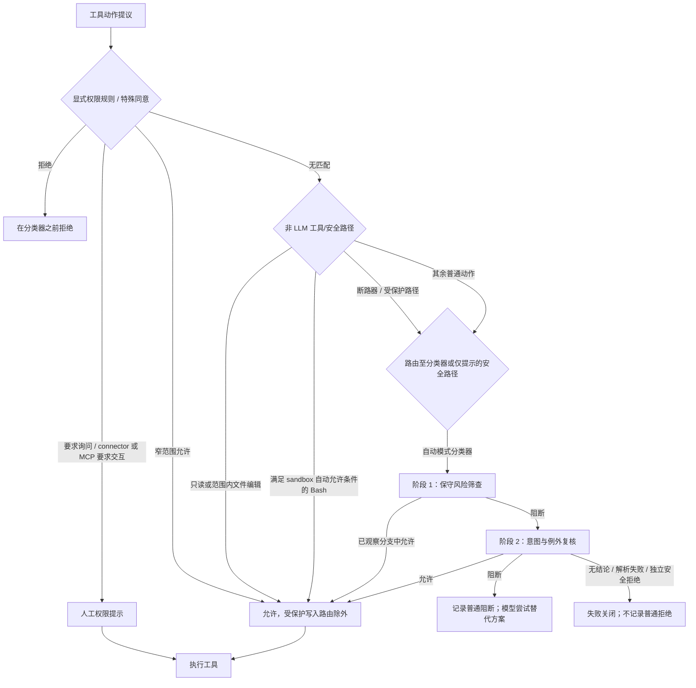

# Claude Code 自动模式权限机制重建

> **范围。** 本文将 Claude Code 2.1.227 的完整 classifier 工件、2.1.227/2.1.232 运行时 trace、公开权限契约与只读二进制观察合并为一个可实施的机制模型。它不是 Anthropic 源码，也不定义 Nano 的当前行为。每个结论均标明证据层级；尚未捕获的分支明确保留为未知。
>
> 本研究包先前已固定 2.1.227 的 Security Monitor system、两阶段 suffix 与 Stage 1 → Stage 2 运行时 capture；2.1.232 的最新增量见 [`claude-code-2.1.232-follow-up.md`](claude-code-2.1.232-follow-up.md)。

## 1. 可以复刻的总体结构

下面的结构是当前官方文档的公共契约，加上本机 binary 对 Bash/safety 分支存在性的交叉核验；它不把所有细节误表述为本地 recovered source。



### 1.1 首个匹配的权限判定顺序 — **官方事实**

Claude Code 在[权限模式：“分类器如何评估动作”](https://code.claude.com/docs/en/permission-modes#when-auto-mode-falls-back)中定义了这一固定顺序：

1. 先判定匹配的 `permissions.allow`、`ask` 或 `deny`；规则优先级本身是 **deny → ask → allow**；
2. 受保护路径写入是例外：即使命中了 allow rule，仍会路由至分类器；
3. 组织要求的 connector approval 与 MCP `_meta["anthropic/requiresUserInteraction"]` 会跳过分类器并直接提示，即使命中了 allow rule；
4. 只读动作及工作目录内的编辑会自动允许，受保护写入除外；
5. 其余所有动作均进入分类器；若被阻断，会向 Claude 返回反馈，使其选择替代方案。

同一文档还说明自动模式（Auto Mode）的特有调整：进入自动模式时，宽泛的任意执行 allow rule（`Bash(*)`、通配 interpreter、包管理器 `run` 与 `Agent` allow）会被暂停；`Bash(npm test)` 之类的窄规则会保留，除非 `autoMode.classifyAllShell=true` 暂停所有 Bash/PowerShell allow rule。

### 1.2 Bash 另有一套权限子系统 — **二进制观察**

二进制 `claude.exe`（SHA-256 `743251…eef6c7`）在 byte offset `258,326,000–258,352,000` 附近嵌入的 JS 中包含 Bash checker，而非仅调用 Security Monitor：

- `VBo` 先匹配精确的 deny/ask/allow rule；`I4d` 再次执行 prefix-level rule 检查、运行额外的安全逻辑，且只会在这些检查之后返回 `Read-only command is allowed` 结果。
- `R8_` 解析 shell AST，拒绝无法安全分类的结构，处理 directory/git/destructive 情形，并组合每个 subcommand 的结果。
- `v4d` 在 `R8_` 的早期调用。仅当 sandbox 与 `autoAllowBashIfSandboxed` 已启用、命令满足 sandbox execution 条件，且通过显式 deny/ask 检查时，它才返回 sandbox 自动允许结果。其结果原因恰为 `Auto-allowed with sandbox (autoAllowBashIfSandboxed enabled)`。
- 每次 spawn 的 `bashCommandClamp` 是独立的失败关闭限制。不匹配或不可验证的命令会返回 `bashCommandClamp: no clamp rule matches this command` 拒绝原因；带 clamp 的 checker 崩溃也会拒绝。

因此，一次 Shell action 至少有以下相互独立的判定来源：显式 rule、sandbox 自动允许、只读识别、AST/安全/断路器结果、模式 fallback 与分类器。minified identifier 和 byte offset 属于特定 build 的证据，不是公开 API，也不意味着本文声称恢复了完整 vendor call graph。

### 1.3 模式与断路器映射 — **二进制观察 + 官方事实**

已安装 bundle 中存在如下内部模式映射函数：

```js
if (mode === "auto") return "classify";
if (mode === "bypassPermissions" || (mode === "plan" && bypassAvailable)) return "allow";
if (mode === "dontAsk") return "deny";
return "ask";
```

它还定义了以下断路器特性：

| 断路器 | 不可被 bypass | 路由至分类器 |
|---|---:|---:|
| `dangerousRemoval` | 是 | 是 |
| `backgroundOperator` | 否 | 是 |
| `suspiciousWindowsPath` | 否 | 是 |
| `isolatePeerMachines` | 是 | 否 |

官方文档独立确认了用户可见含义：对 root/home 的 destructive removal 即使在 `bypassPermissions` 中仍是断路器；在自动模式中，它会路由至分类器。connector-required consent、显式 `ask` 与 MCP interaction-required tool 即使在 bypass mode 中仍保持提示。bundle 中的值本身**不能**揭示每个 caller 或 UI recovery path。

## 2. 分类器收到什么、如何判定

### 2.1 条件式两阶段 — **运行时观察**

此前受控的 `curl -fsS http://127.0.0.1:9 | bash` trace 捕获到：

```text
Stage 1 Security Monitor request
  → <block>yes</block>, Code from External
Stage 2：相同 system + 相同 transcript + Stage 2 suffix
  → <block>no</block>
```

Stage 1 使用 `max_tokens=2112` 和 `stop_sequences=["</block>"]`；Stage 2 使用 `max_tokens=10240`，没有 stop sequence。各自的 suffix 说明 Stage 1 不得应用 user intent/ALLOW 例外，而 Stage 2 执行完整审查。这为该 2.1.227 runtime/model route 确立了 **条件式 Stage 1 block → Stage 2** 路径；2.1.232 补充研究独立观察到同样的 2,112/10,240 请求参数，且两个阶段均返回 block。两条 trace 都不能证明每种工具类型都使用这对阶段。

### 2.2 可信 transcript 边界 — **官方事实 + 运行时观察**

官方文档说明，分类器能看到 user messages、tool calls 和 `CLAUDE.md`，而 tool results 会被剥离。捕获到的 classifier input 具体包含 human instruction 与待执行 `Bash` command 的 JSON projection，但不包含 tool-result payload。这正是避免将 web/file/tool 内容误当作 human authorization 所需的来源边界。

当前 Security Monitor policy 还使用 environment、trust、sensitivity、source、destination 和 user-intent 等概念。配置不是由 repository 控制的 prompt injection surface：`autoMode` 读取 user settings、managed settings 或内联 `--settings`/SDK JSON，不读取 project `.claude/settings*.json`；可用 `$defaults` 显式保留默认值。

### 2.3 分类器内部的配置优先级 — **官方事实**

公开的 `autoMode` policy 有四组 prose rule，其优先级仅在分类器内部生效：

```text
hard_deny
  > soft_deny (may be cleared by matching allow or specific explicit user intent)
  > allow (exception to soft_deny)
  > remaining explicit user intent
```

这与 tool-pattern `permissions.deny` 不同：后者在分类器之前运行，不能被 intent 或 classifier configuration 覆盖。`environment` 定义的是可信基础设施与 sensitivity slots，而不是无条件 allowlist。

## 3. 结果、失败、重试与状态

### 3.1 普通阻断生命周期 — **官方事实**

一次普通 classifier block 会：

1. 阻止执行，并向 Claude 返回反馈；
2. 出现在 `/permissions` → **Recently denied**；
3. 可用 `r` 标记为 retry；退出 dialog 会向 Claude 提供 retry instruction；
4. 正常情况下会促使 Claude 寻找替代方案、补充缺失的 explicit user intent，或使用已配置的 trusted destination/rule。

文档化的 circuit breaker 是 session state，而非 prompt convention：

- 连续 3 次 block，或累计 20 次 block，会暂停 Auto Mode 并回到 prompting；
- 任意一次 allowed action 只会重置连续计数器；
- 累计计数会持续保留，直到该计数器自身触发 fallback；
- 若 mode switch 使 pending classifier verdict 不再适用，该 verdict 会被丢弃。

在没有 permission-prompt tool 的 headless `-p` 中，不存在 manual fallback：被拒绝的 action 不会运行，main/subagent conversation 继续进行。

### 3.2 无结论（no-verdict）生命周期 — **官方事实 + 二进制观察**

classifier API failure、parse failure、transcript-too-long，或独立 safety layer 拒绝 classifier request 时，系统会失败关闭（fail-closed）。它与普通 block 的差别是：

- action 会被拒绝；
- 不会加入 **Recently denied**，也不会增加普通 repeated-block counter；
- 在存在 prompt 的地方，transcript-too-long 会回退到 manual approval；
- headless run 无法提示，并会在不执行该 action 的情况下继续。

本地 bundle 暴露了相应的 reason labels：`Classifier unavailable`、`Auto mode could not evaluate this action and is blocking it for safety`、`Auto mode classifier transcript exceeded context window`、`parse_failure` 和 `tengu_auto_mode_outcome`。它们的存在佐证了文档所列类别，但不能替代 runtime failure trace。

### 3.3 Sandbox 网络 verdict cache — **官方事实**

Sandbox network request 会路由至分类器。Claude Code 按 host 和 port 缓存其 verdict：

- allow 会保留到新的 conversation content 进入为止，随后该 host 会重新评估；
- interactive deny 会在 turn 结束时丢弃；
- headless/SDK deny 因没有 turn boundary，会在该 run 的剩余时间内持续存在；
- 更改 rules 或 permission mode 会清空 cache。

Sandbox auto-allow 是一条独立的、由 OS 强制的 capability path：符合条件的 sandboxed Bash command 无需 prompt 即可运行；无法 sandbox 的 command 则回到常规 permission flow，并可能在 Auto Mode 下进入 classifier。显式 deny/ask 与 destructive-removal safeguard 仍然适用。

## 4. 多 Agent 与消息生命周期

### 4.1 子 Agent — **官方事实 + 运行时观察**

当前官方文档规定三次 review：

1. spawn 前，classifier review delegated task；
2. classifier review 每个 subagent action，忽略写在 subagent frontmatter 中的 `permissionMode`；
3. results return 前，classifier review 已完成的 subagent action history。若发现 concern，会前置 security warning；若独立 safety check 拒绝该 review，results 仍会返回，但标记为 unreviewed/untrusted。

2.1.232 的两条隔离 runtime trace 又直接闭合了全部三段 allow path：main Agent 提议
`general-purpose` delegation 后，Stage 1 先 review task 并 allow，之后才出现 `task_started`；
child 提议唯一 Bash action 后，另一 Stage 1 先 allow，之后才执行；child 返回 `42`
后，completion Stage 1 将 hand-back 明确标记为 agent-authored untrusted output，通过后才向
main loop 交付 tool result。完整 manifest 见
[`claude-code-2.1.232-follow-up.md`](claude-code-2.1.232-follow-up.md#6-subagent-spawn-与-completion-runtime-trace)。

### 4.2 `SendMessage` — **官方事实 + 运行时观察**

在 Auto Mode 以及启用了 classifier 的 Plan Mode（v2.1.222+）中，classifier 会在 delivery 前 review 每一个 `SendMessage`，无论它是 plain 还是 structured。policy 默认允许同一 multi-agent session 内 agent 之间的普通消息，但那是 policy conclusion，并非对整个 harness 的 blanket bypass。cross-session/machine safeguard 还会在 bypass mode 中继续生效。

2.1.232 的 nonexistent-target 探针进一步证明 pre-delivery 顺序：classifier transcript 同时携带
recipient、content 和 summary，Stage 1 返回 allow 后才 dispatch；随后工具因目标不存在明确
返回 `Not sent`。该 trace 没有真实 delivery，也不覆盖 successful/cross-session 或 block path；
manifest 见 [`claude-code-2.1.232-follow-up.md`](claude-code-2.1.232-follow-up.md#7-sendmessage-pre-delivery-runtime-trace)。

## 5. 三个最小运行时探针

以下 probes 使用 `--bare --permission-mode auto --print --verbose --output-format stream-json`、全新的 `mktemp -d` directory，以及既有的 local LLM Proxy route。补充研究仅加入 `--debug-file`，以暴露 CLI 自身的 decision reason。被测试的 tools 未触及任何 repository file、service、network target 或 credential。

| 探针 | 运行时结果 | Proxy 证据 | 可证明什么 | 不能证明什么 |
|---|---|---|---|---|
| `pwd` | 执行一次；session `244fa26b-88b7-48dc-bc45-682ffdd7548d` | `/Users/czj/Repos/LLM_PROXY/logs/session/2026-08-13_10-36-45_261_244fa26b-88b7-48dc-bc45-682ffdd7548d/`；3 次 main-model request，零次 Security Monitor request | 该 command 绕过了 LLM classifier；官方 read-only-command contract 可解释此结果 | 通用 Bash/write routing 或 sandbox state |
| `mkdir cc_auto_permission_probe_dir` | 执行一次；session `7b571260-b1af-42e9-a191-1f3a41f03bb5` | `/Users/czj/Repos/LLM_PROXY/logs/session/2026-08-14_00-05-26_300_7b571260-b1af-42e9-a191-1f3a41f03bb5/`；3 次 main-model request，零次 Security Monitor request | 此 in-scope local filesystem command 在本次 run 中绕过 LLM classifier | 仅凭首个 transcript 尚不能命名最终命中的 branch |
| 相同的 `mkdir`，加上 CLI `--debug-file` | 执行一次；session `4946e865-fbb3-4478-b954-15eaf91308c4`；decision 耗时 68 ms | `/Users/czj/Repos/LLM_PROXY/logs/session/2026-08-14_18-15-33_346_4946e865-fbb3-4478-b954-15eaf91308c4/`；3 次 main-model request，零次 Security Monitor request | CLI 记录 `Skipping auto mode classifier for Bash: would be allowed in acceptEdits mode`；官方文档将 in-scope `mkdir` 列为 Accept Edits 固定自动批准的 Bash operation | 完整的内部 Accept Edits matcher call graph，或其他 command 的 routing |

首个 `mkdir` transcript 记录了 tool calls/results，但没有 permission-decision reason。另一次 ephemeral run 设置了 `AUTOMODE_DECISION_LOG=1`；它成功完成，却没有创建 `.automode_decisions.jsonl`，因此未提供 attribution，未纳入上表。原计划的 one-shot control 使用内联 `--settings '{"sandbox":{"enabled":false}}'`，被当时活跃的 assistant security gate 两次拒绝，其中一次发生在 explicit user approval 之后；Claude Code 没有启动，且没有 setting/file 被改变。后来的 `--debug-file` trace 使这一较低隔离度的 control 不再必要：它直接命名了 Accept Edits path，因而无需禁用 sandbox 即闭合了原始 attribution question。

## 6. 证据状态表

| 命题 | 证据 | 置信度 | 仍需的判别证据 |
|---|---|---:|---|
| Auto Mode 是权限拓扑，而不只是两个 prompt | 官方固定判定顺序；binary Bash checker；运行时 `pwd` 和 `mkdir` 无 classifier trace | 高 | 这一结论无需更多证据 |
| `pwd` 经由 read-only path 绕过 classifier | 官方 read-only list 列出 `pwd`；运行时 trace 没有 Security Monitor request | 高 | 无 |
| in-scope `mkdir` 经由 Accept Edits/local-file-operation path 绕过 classifier | CLI decision reason + 官方固定 `mkdir` rule + 零次 Security Monitor request | 对此 command/build 为高 | 仅当需要 implementation-level parity 时，才需完整内部 Accept Edits matcher call graph |
| subagent spawn、child action 和 completion result 都在 dispatch/交付前 review | 2.1.232 七请求 trace；三个独立 Stage 1 allow；debug dispatch 时序 | 对 single-Bash child allow path 为高 | Stage 2 block 与 completion warning/failure path |
| `SendMessage` 在 delivery 前 review recipient/content/summary | 2.1.232 nonexistent-target 三请求 trace；classifier allow 早于 dispatch；tool 明确 `Not sent` | 对 nonexistent-target allow path 为高 | successful/cross-session 与 block path |
| sandbox auto-allow 在允许 eligible Bash 前检查 deny/ask | recovered `v4d`/`_8_` branch | 对此 build 为高 | 所有 edge case 的 source 或 runtime decision event |
| 每个任意 CC tool 都遵循已恢复的 Bash 顺序 | 不支持 | 低 | tool-specific trace/static call chain |
| 当前 two-stage classifier 用于每个 routed action | 不支持 | 低 | 有判别力的 tool-type matrix |
| 已重建完整 callback/UI/approval implementation | 不支持 | 低 | source 或 targeted interactive trace |

## 7. 对 Nano 实施的含义 — **综合推论，不是当前行为**

未来 Nano 的变更不应将 vendor text 直接移植到 `auto_mode_gate.py`。它应引入显式、typed 的 permission orchestrator，使其 decision source 可观察、可测试，例如：

```text
策略规则 / 特殊 consent
→ tool-specific deterministic safety check
→ read-only 或 capability-backed sandbox fast path
→ classifier Stage 1 / 条件式 Stage 2
→ normal-denial ledger 或 no-verdict fail-closed path
→ CLI prompt 或 PA PermissionBroker park/resume
```

实施前需要设计的最小语义增量：

1. **将 decision source 与 decision behavior 分开。** 保留 `allow`/`ask`/`deny`，但附加稳定的 source，如 `rule`、`read_only`、`tool_safety`、`classifier`、`classifier_no_verdict` 和 `broker`。counter semantics 只能计入普通 classifier block。
2. **让 provenance 结构化。** 由可信 human instruction、pending action projection、tool/action history、source/destination facts、environment/trust/sensitivity slots 与显式 run origin 构造 classifier input。不得从 tool output 或 assistant assertion 恢复 intent。
3. **将 fast path 定义为 product contract。** Nano 没有可机械照搬的 Claude OS sandbox；它必须独立决定哪些 read-only 与 local operation 足够确定性地绕过 classification，并保留不可 bypass 的 dangerous-path check。
4. **将 channel delivery 纳入同一 external-action model。** 若 Nano 采用 outbound-submission semantics，`send_message` 不得继续作为 generic safe-tool bypass。destination、content、identity 与 explicit user authorization 需要各自的 typed facts。
5. **将 agent/subagent completion 视为 action review surface。** spawn delegation、child tool action、child result return 与 cross-agent message 是不同的 checkpoint，而非一次 `agent` tool call。
6. **有意识地建模 PA recovery。** classifier no-verdict、standard block、repeated-block fallback 和 explicit ask 具有不同的 ledger/counter/prompt behavior。parked PA hook 必须恰好 resume 一次，且不得使无人值守执行 deadlock。

与这些要求冲突的当前 Nano seams 已记录在 [`research.md`](research.md)：`SAFE_TOOL_ALLOWLIST` 在 `src/agent/platform/hooks/builtins/auto_mode_gate.py:187-196` 包含 `send_message`；transcript construction 在 `:300-380,624-658` 排除 assistant text 且缺少 typed environment provenance；现有 tool/broker control flow 位于 `:810-1039`。这是一个独立的 permission-system change unit，不属于 bugfix-535。
